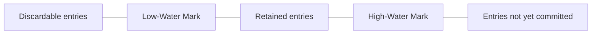

# Low-Water Mark

## Description

The Low-Water Mark is an index (offset) in the log below which entries are no longer needed and can be safely discarded. It solves the problem of unbounded disk growth: even with the Segmented Log limiting each file's size, the total would keep growing without a rule for deleting the past.

This mark can be computed in different ways. One is based on *snapshots*: once the state up to a given index has been written to a snapshot, the log before it is disposable. Another is based on time or size: log older than a retention period is removed. In replicated systems, you also need to consider what followers still need, so you don't delete entries that a slow follower hasn't received yet.

A background process periodically checks the mark and removes the segments that lie entirely below it. Kafka uses time- or size-based retention, and ZooKeeper and etcd use snapshots followed by log compaction.

## Problems it solves

- The Write-Ahead Log grows indefinitely and consumes all the disk.
- It's unclear how far back the history is needed for recovery or for lagging followers.
- Deleting entries too early can prevent recovery or the resynchronization of replicas.

## When to use

- Logs that accumulate more history than recovery needs.
- When periodic snapshots make the earlier log redundant.
- When there's a retention policy by time or size.

### When to avoid

- When the full history must be kept for auditing or replay (for example, event sourcing with infinite retention).
- When the volume is small and the cost of keeping the whole log is negligible.

## Trade-offs

| Benefit | Cost / Risk |
| --- | --- |
| Bounded, predictable disk usage | Very lagging followers or consumers may need a full snapshot, because the log they need has already been deleted |
| Faster recovery, starting from the snapshot | Requires producing snapshots, which consumes CPU and I/O |
| Retention policy that's simple to operate | Choosing the mark poorly causes data loss or wasted space |

- **Slow followers:** the mark must respect the lowest offset still needed by live replicas, or else force a snapshot transfer.
- **Atomicity:** remove only whole segments below the mark.

## Diagram

The log is divided into three zones: what can already be discarded, what is retained and committed, and what has not yet been replicated by the majority.

## Related patterns

- [Write-Ahead Log](/architecture/distributed-systems/data-replication/write-ahead-log) — the log whose growth the mark limits
- [Segmented Log](/architecture/distributed-systems/data-replication/segmented-log) — makes it easy to remove segments below the mark
- [High-Water Mark](/architecture/distributed-systems/data-replication/high-water-mark) — complementary mark, at the upper end of the log
- [Replicated Log](/architecture/distributed-systems/data-replication/replicated-log) — the mark must account for what followers still need

## Reference

- [Pattern page in the Patterns of Distributed Systems catalog](https://martinfowler.com/articles/patterns-of-distributed-systems/low-watermark.html)
