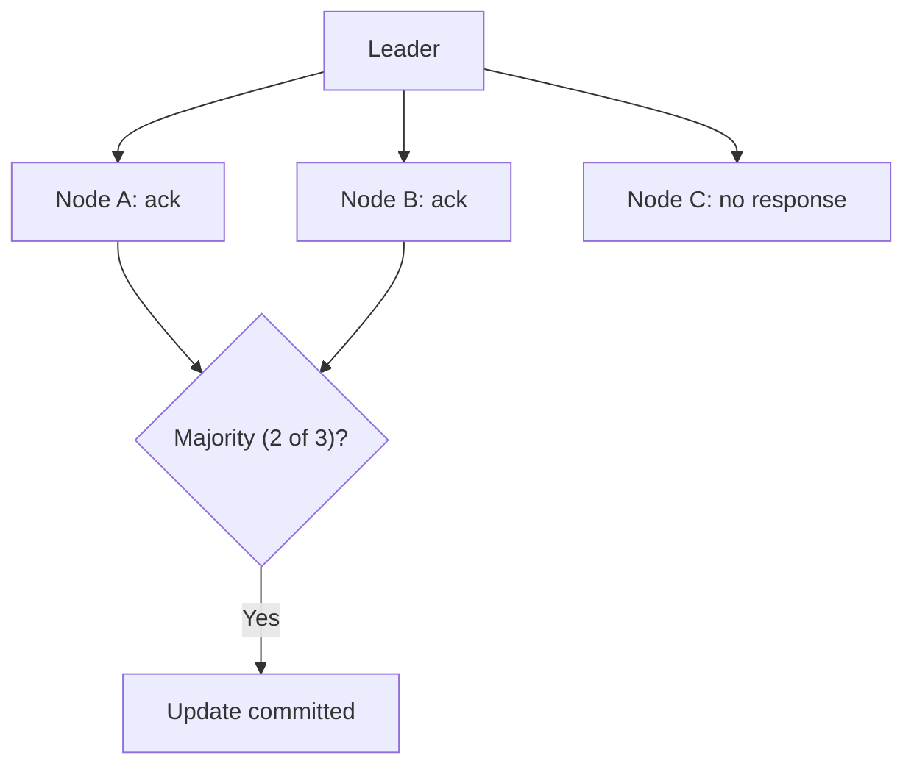

# Majority Quorum

## Description

In Majority Quorum, an update is considered accepted by the cluster only when a majority of nodes acknowledge it. For a cluster of n nodes, the quorum is n/2 + 1 (integer division). In a five-node cluster the quorum is three, and the system tolerates two failures. To tolerate f failures, 2f + 1 nodes are needed.

Waiting for all nodes would make the system slow and vulnerable to any failure; waiting for too few would risk losing updates. A majority balances the two: any two majorities always intersect, so any later decision has at least one node that knows about the earlier one.

The pattern appears in ZooKeeper, etcd, Raft, and Paxos to commit writes and elect leaders, and in Cassandra, where the read and write quorums are configurable.

## Problems it solves

- Deciding how many acknowledgments are needed before an update is considered safe.
- Avoiding lost updates when few nodes acknowledge and then fail.
- Avoiding slowness and unavailability from requiring acknowledgment from all nodes.
- Ensuring that concurrent decisions don't conflict (majority intersection).

## When to use

- Replication where a write must survive the failure of some nodes.
- Leader election and consensus.
- Group decision-making where an isolated minority segment must not keep operating.

### When to avoid

- Two-node or even-sized clusters, where the quorum tolerates no more failures than the previous odd size.
- When the latency of waiting for a majority across distant regions is unacceptable and eventual consistency is enough.

## Trade-offs

| Benefit | Cost / Risk |
| --- | --- |
| Tolerates failures without losing committed data | Requires 2f + 1 nodes and communication with a majority on every write |
| Prevents split brain: only one partition has a majority | Without a majority, the cluster stops accepting writes (favors consistency over availability) |
| Faster than waiting for all nodes | Latency is dominated by the slowest nodes within the majority |

- **Odd number of nodes:** 3 or 5 are typical sizes.
- **Flexible quorum:** choosing R + W > N in systems such as Cassandra tunes the balance between reads and writes.
- **Membership changes:** reconfiguring the cluster requires care so that the old and new majorities overlap.

## Diagram

In a three-node cluster, two acknowledgments are enough to consider the update accepted, even with one node unresponsive.

## Related patterns

- [Leader and Followers](/architecture/distributed-systems/data-replication/leader-and-followers) — the leader uses the quorum to commit writes
- [High-Water Mark](/architecture/distributed-systems/data-replication/high-water-mark) — marks the last entry replicated to a majority
- [Paxos](/architecture/distributed-systems/data-replication/paxos) — uses majority quorums in the prepare and accept phases
- [Replicated Log](/architecture/distributed-systems/data-replication/replicated-log) — entries are committed only after the quorum
- [Two-Phase Commit](/architecture/distributed-systems/data-partitioning/two-phase-commit) — a contrast: it requires all participants, not just a majority

## Reference

- [Pattern page in the Patterns of Distributed Systems catalog](https://martinfowler.com/articles/patterns-of-distributed-systems/majority-quorum.html)
