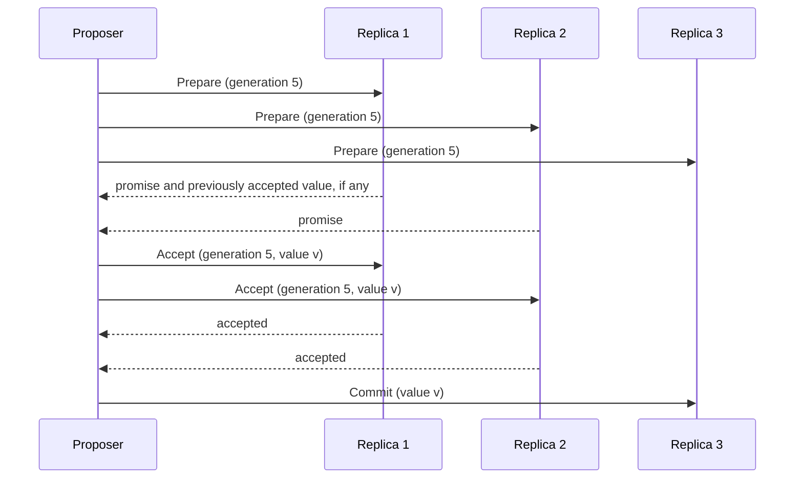

# Paxos

## Description

Paxos is a consensus protocol, proposed by Leslie Lamport, that lets a group of nodes agree on a value despite node and network failures and without a fixed leader. The problem is subtle: a node can get a majority to accept a value and crash before telling the rest of the cluster, and another node, unaware of this, may try to impose a different value.

The protocol uses three phases. In Prepare, the proposer picks a generation number (Generation Clock) higher than any it has seen and sends it to a quorum, which promises to ignore lower generations and returns any value it has already accepted. In Accept, the proposer proposes a value (the one with the highest accepted generation, if any, or its own) and the replicas accept it if they haven't promised a higher generation. In Commit, the chosen value is broadcast to all replicas.

Basic Paxos decides a single value; Multi-Paxos repeats the process for a sequence of values and, in practice, is the basis of replicated logs. Raft and ZAB have similar ideas. Google Chubby and Spanner use variants of Paxos.

## Problems it solves

- Nodes with no central coordinator need to agree on a value.
- Nodes can fail or become isolated at any time.
- Concurrent proposals may try to impose different values.
- A partial decision made by a majority but not broadcast must not cause inconsistency.

## When to use

- When consensus is needed without relying on a fixed leader, or to elect the leader.
- As the basis of a Replicated Log in systems that require strong consistency.
- To agree on critical cluster configuration or metadata.

### When to avoid

- When plain Leader and Followers with an external consensus service (ZooKeeper, etcd) solves the problem; avoid implementing Paxos from scratch.
- Systems that tolerate eventual consistency.

## Trade-offs

| Benefit | Cost / Risk |
| --- | --- |
| Guaranteed safety even with failures and delayed messages | High conceptual and implementation complexity |
| Works without a fixed leader | Concurrent proposals can step on each other (livelock) without a stable leader |
| Tolerates f failures with 2f + 1 nodes | Two round trips per value in basic Paxos |

- **Multi-Paxos:** elects a stable proposer to skip the prepare phase in subsequent decisions.
- **Alternatives:** Raft was designed to be easier to understand and implement.

## Diagram

The proposer gets promises from a majority in the prepare phase, proposes the value in the accept phase, and broadcasts the result in the commit phase.

## Related patterns

- [Generation Clock](/architecture/distributed-systems/data-replication/generation-clock) — identifies the generations of the proposals
- [Majority Quorum](/architecture/distributed-systems/data-replication/majority-quorum) — all phases depend on a majority
- [Replicated Log](/architecture/distributed-systems/data-replication/replicated-log) — Multi-Paxos applies consensus to each log entry
- [Leader and Followers](/architecture/distributed-systems/data-replication/leader-and-followers) — an alternative with a stable leader, which simplifies the protocol
- [Consistent Core](/architecture/distributed-systems/cluster-management/consistent-core) — small consensus services use Paxos or Raft

## Reference

- [Pattern page in the Patterns of Distributed Systems catalog](https://martinfowler.com/articles/patterns-of-distributed-systems/paxos.html)
