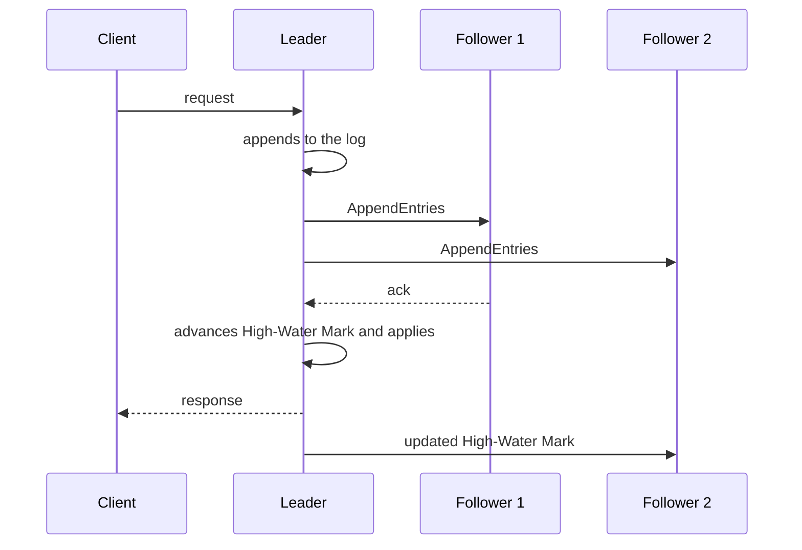

# Replicated Log

## Description

In Replicated Log, each node in the cluster keeps a Write-Ahead Log whose entries hold the user requests and the state needed for consensus. The nodes work together so that all of them have exactly the same log, and requests are executed in log order. If everyone agrees on each entry and applies them in the same order, everyone reaches the same state: this is the replicated state machine technique.

In practice, the leader appends the entry to its log, replicates it to the followers and, once a majority has acknowledged it, advances the High-Water Mark and applies the entry to the state machine, responding to the client. Followers with divergent logs after a leader change have the conflicting entries truncated and replaced based on the generation.

It's the heart of Raft, ZAB (ZooKeeper), etcd, and Kafka partition replicas.

## Problems it solves

- Nodes need to keep the same state despite failures and disconnections.
- Agreeing on each request isn't enough: they must be executed in the same order on all replicas.
- Divergent logs after leader failures need to be reconciled.

## When to use

- Databases, coordination services, and queues that require strong consistency with fault tolerance.
- When all replicas must execute the same set of commands in the same order.
- As the foundation for a Consistent Core.

## When to avoid

- Workloads that tolerate eventual consistency and can use simpler asynchronous replication.
- Heavy write workloads where per-entry consensus is a bottleneck, without batching or pipelining.

## Trade-offs

| Benefit | Cost / Risk |
| --- | --- |
| All replicas converge to the same state, with a total order | Every write pays a network trip to the majority |
| Tolerates minority failures without losing committed data | Complexity of reconciling divergent logs after leader changes |
| A durable log allows recovery and resynchronization of replicas | Requires compaction and snapshots to avoid infinite growth |

- **Performance:** combine with Request Batch and Request Pipeline.
- **Waiting for responses:** the leader uses a Request Waiting List to respond to the client after the commit.
- **Idempotency:** clients that retry requests need an Idempotent Receiver.

## Diagram

The leader appends the entry, replicates it, advances the High-Water Mark when a majority acknowledges, applies the entry, and responds to the client.

## Related patterns

- [Write-Ahead Log](/architecture/distributed-systems/data-replication/write-ahead-log) — each node keeps a local WAL
- [Leader and Followers](/architecture/distributed-systems/data-replication/leader-and-followers) — the leader coordinates replication
- [High-Water Mark](/architecture/distributed-systems/data-replication/high-water-mark) — delimits the committed entries
- [Majority Quorum](/architecture/distributed-systems/data-replication/majority-quorum) — defines the entry commit
- [Paxos](/architecture/distributed-systems/data-replication/paxos) — consensus protocol for each entry
- [Request Waiting List](/architecture/distributed-systems/data-replication/request-waiting-list) — tracks requests until commit
- [Idempotent Receiver](/architecture/cloud-design-patterns/messaging/idempotent-consumer) — avoids applying repeated requests twice
- [Consistent Core](/architecture/distributed-systems/cluster-management/consistent-core) — small service built on top of a replicated log
- [Event Sourcing](/architecture/cloud-design-patterns/data-management/event-sourcing) — state derived from an event log, without consensus replication
- [Transaction Log Tailing](/architecture/microservices/transactional-messaging/transaction-log-tailing) — reads the transaction log to publish changes

## Reference

- [Pattern page in the Patterns of Distributed Systems catalog](https://martinfowler.com/articles/patterns-of-distributed-systems/replicated-log.html)
