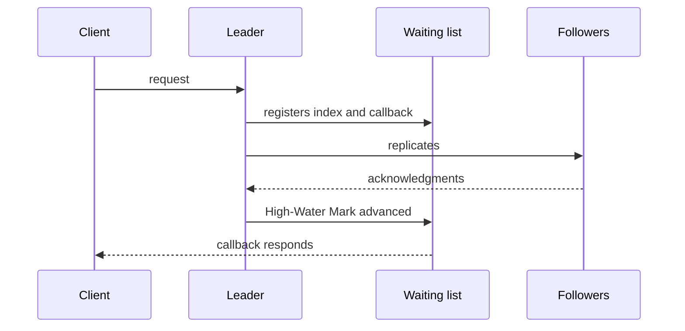

# Request Waiting List

## Description

A Request Waiting List is a structure that maps a key to a callback function. When a cluster node needs to replicate data to serve a client request, it can respond only after receiving acknowledgments from all nodes or from a majority. Because communication is asynchronous, the responses arrive at different times and must be correlated with the original request.

The key depends on the criterion that triggers the callback. It can be each message's correlation identifier, if the callback is invoked on every response received, or, in a Replicated Log, the log index: when the High-Water Mark reaches that index, the corresponding request is completed. The callback inspects the response and decides whether the client's request can be fulfilled.

It usually also has a timeout, to fail requests that don't reach the quorum.

## Problems it solves

- Asynchronous responses from several nodes need to be correlated with the client's request.
- You need to know when the quorum has been reached for each request.
- The client can't be answered before replication is confirmed.

## When to use

- Nodes that replicate data and wait for the quorum before responding.
- When using Request Pipeline and Request Batch and there are many requests in flight.
- In replicated-log leaders that respond after the commit.

### When to avoid

- Simple synchronous communication with a single recipient, where blocking the call is enough.
- When there's no need to wait for acknowledgments.

## Trade-offs

| Benefit | Cost / Risk |
| --- | --- |
| Enables asynchronous communication and high performance | More in-memory state to keep track of |
| Cleanly correlates responses with requests | Pending callbacks need a timeout and cleanup to avoid leaks |
| Responds to the client at the exact moment of quorum or commit | Losing the list in a crash requires clients to retry (Idempotent Receiver) |

- **Timeouts:** expire entries and respond to the client with an error.
- **Leadership change:** fail all pending requests when the node stops being the leader.

## Diagram

The leader registers a callback per index and fires it when replication reaches the quorum, responding to the client.

## Related patterns

- [Replicated Log](/architecture/distributed-systems/data-replication/replicated-log) — uses the log index as the key
- [Majority Quorum](/architecture/distributed-systems/data-replication/majority-quorum) — defines when the callback is fired
- [High-Water Mark](/architecture/distributed-systems/data-replication/high-water-mark) — when it advances, it completes the pending requests
- [Singular Update Queue](/architecture/distributed-systems/data-replication/singular-update-queue) — tracks the serialized execution of requests

## Reference

- [Pattern page in the Patterns of Distributed Systems catalog](https://martinfowler.com/articles/patterns-of-distributed-systems/request-waiting-list.html)
