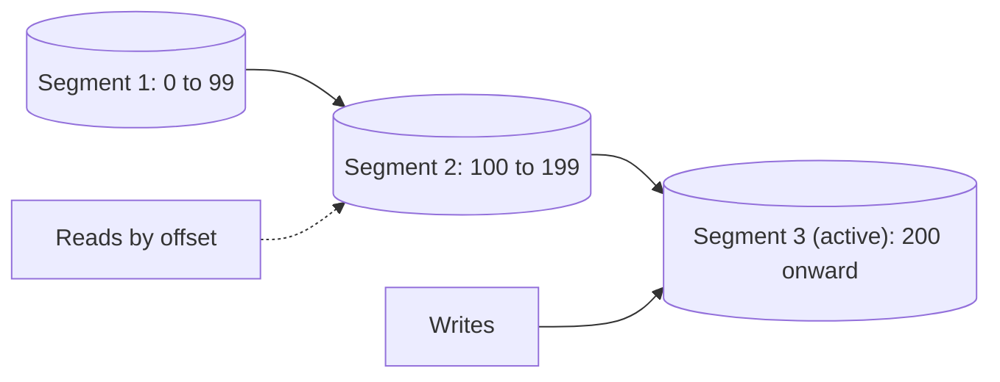

# Segmented Log

## Description

The Segmented Log splits the Write-Ahead Log into several smaller files, called segments, instead of keeping a single file that grows indefinitely. When the active segment reaches a limit (of size or time), the log "rolls": the file is closed and a new segment is created to receive the next records. Only the last segment receives writes, and the earlier ones stay immutable.

Each segment is usually named after, or associated with, the first index (offset) it contains. Given an index, a small table or the file names themselves make it possible to find the right segment without scanning everything. Since old segments are independent files, deleting or archiving the past becomes a simple matter of removing whole files.

Kafka organizes each partition as a sequence of segments, and Cassandra, ZooKeeper, and etcd do something equivalent for their transaction logs.

## Problems it solves

- A single large log file is slow to read at startup and hard to manipulate.
- Removing old records from inside a huge file is expensive and complicated.
- Searching for a specific index in a monolithic log requires extensive sequential reading.
- Limiting each file's size simplifies backup, copying to followers, and disk management.

## When to use

- Any Write-Ahead Log that grows continuously, especially replicated logs.
- When old history needs to be discarded periodically (retention by time or size).
- When recovery needs to read only the most recent segments.

## When to avoid

- Small data volumes, where a single file remains manageable.
- When the log is ephemeral and discarded entirely on each restart.

## Trade-offs

| Benefit | Cost / Risk |
| --- | --- |
| Cheap cleanup: delete a whole segment | More open files and metadata to maintain, with the need for a segment index |
| Faster reads and recovery, limited to the relevant segments | The rolling moment needs care to avoid losing write atomicity |
| Immutable segments are easy to copy and replicate | Segments that are too small add overhead; too large lose the benefit |

- **Segment size:** balance the number of files against cleanup granularity.
- **Offset index:** keeping the first offset in the file name allows binary search across segments.
- **Cleanup:** the decision of which segments to remove comes from the Low-Water Mark.

## Diagram

The log is a sequence of immutable segments plus an active segment, the only one that receives new writes.

## Related patterns

- [Write-Ahead Log](/architecture/distributed-systems/data-replication/write-ahead-log) — the log that is split into segments
- [Low-Water Mark](/architecture/distributed-systems/data-replication/low-water-mark) — indicates which old segments can be removed
- [Replicated Log](/architecture/distributed-systems/data-replication/replicated-log) — the replicated log is usually stored in segmented form

## Reference

- [Pattern page in the Patterns of Distributed Systems catalog](https://martinfowler.com/articles/patterns-of-distributed-systems/segmented-log.html)
