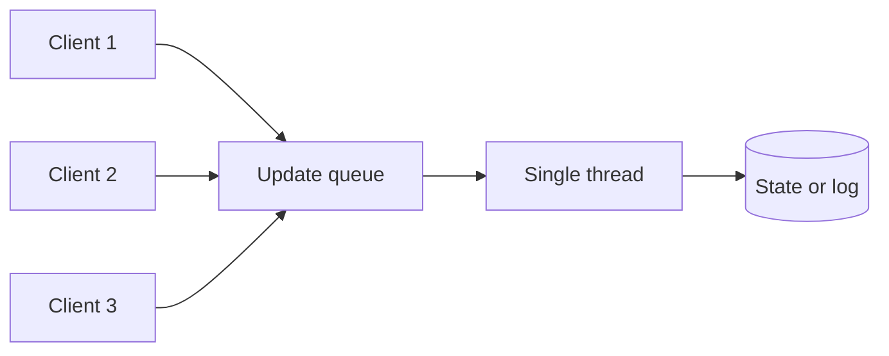

# Singular Update Queue

## Description

A Singular Update Queue uses a work queue processed by a single thread to apply state changes. Multiple concurrent clients submit their updates to the queue (without blocking) and a dedicated thread takes them off and executes them one at a time, in arrival order.

Instead of protecting the state with locks, where concurrent threads block waiting and throughput drops when the task is slow (such as writing to a file), the state is confined to one thread. Callers get a promise (*future*) or callback that completes when the update is processed. The idea pairs well with goroutines and channels in Go, or with a *single-thread executor* in Java.

It shows up around the Write-Ahead Log, to serialize writes to the log, and in applying the committed entries of a Replicated Log.

## Problems it solves

- Several concurrent threads need to change the same state, but the changes must be applied one at a time.
- Locks block the waiting threads, reducing throughput and increasing latency when the task is slow.
- You need to preserve execution order and simplify reasoning about concurrency.

## When to use

- Sequential writing to a Write-Ahead Log with concurrent writes.
- Applying commands to a replicated state machine.
- When the shared state is complex and locks would make the code fragile.

### When to avoid

- Highly parallelizable workloads where operations are independent (use competing consumers or partitioning).
- When a single thread is a CPU bottleneck that can't be divided.

## Trade-offs

| Benefit | Cost / Risk |
| --- | --- |
| Guaranteed order and no locks on the state | Throughput limited by the speed of a single thread |
| Callers don't block during execution | An unbounded queue can grow and consume memory |
| Code that's simpler to understand | Slow tasks delay all the following ones |

- **Backpressure:** use a bounded queue and reject or block when it's full.
- **Batching:** the thread can process several items per cycle to amortize the cost of `fsync`.
- **Errors:** handle exceptions without taking down the consumer thread.

## Diagram

Several clients enqueue updates and a single thread applies them to the state in order.

## Related patterns

- [Write-Ahead Log](/architecture/distributed-systems/data-replication/write-ahead-log) — writes to the log are serialized by this queue
- [Replicated Log](/architecture/distributed-systems/data-replication/replicated-log) — committed entries are applied in order by a single thread
- [Request Waiting List](/architecture/distributed-systems/data-replication/request-waiting-list) — registers callbacks for queued requests
- [Competing Consumers](/architecture/cloud-design-patterns/messaging/competing-consumers) — a contrast: several consumers in parallel, with no global order

## Reference

- [Pattern page in the Patterns of Distributed Systems catalog](https://martinfowler.com/articles/patterns-of-distributed-systems/singular-update-queue.html)
