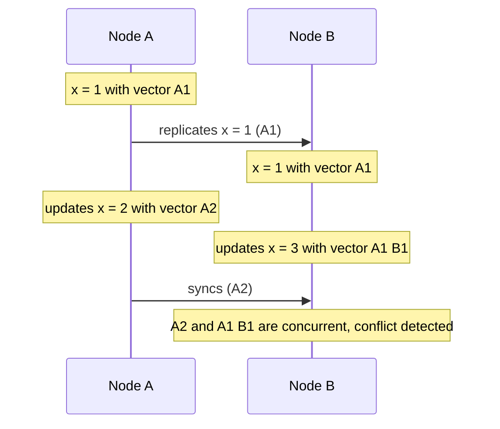

# Version Vector

## Description

The Version Vector associates with each value of a key a vector holding one counter per node in the cluster. When a node updates the value locally, it increments only its own counter. When replicas exchange data, they compare the vectors: if one vector is greater than or equal to the other in every position, its value is newer and replaces the other; if each is greater in some position, the updates were concurrent, and there's a conflict to resolve.

Resolution can be done by the client, by a rule such as *last-write-wins*, or by mergeable data types (CRDTs). This lets several servers accept writes for the same key without a leader and detect conflicts afterward, instead of preventing them.

It's used in Dynamo and Riak; Cassandra opted for timestamps (last-write-wins) instead of vectors.

## Problems it solves

- When several servers accept updates for the same key, you need to detect whether replicas received concurrent modifications.
- Physical clocks aren't reliable for ordering events across nodes.

## When to use

- Leaderless stores with multi-master replication and high write availability.
- When conflicts must be detected and resolved explicitly, rather than silently discarded.

### When to avoid

- Single-leader systems, where the order is already defined (use Versioned Value).
- Very large clusters, since the vector grows with the number of nodes.
- When last-write-wins is acceptable.

## Trade-offs

| Benefit | Cost / Risk |
| --- | --- |
| Detects concurrent updates without synchronized clocks | The vector size grows with the number of nodes or clients |
| Allows writing to any replica, with high availability | Conflicts need resolution, which can be complex |
| Preserves causality between updates | More complex than a simple version number |

- **Pruning:** limit the vector size by removing old entries, at the cost of precision.
- **Dotted version vectors:** reduce per-client growth.

## Diagram

Two nodes update the same key without knowing about each other's update; on synchronization, comparing the vectors reveals the conflict.

## Related patterns

- [Versioned Value](/architecture/distributed-systems/data-replication/versioned-value) — a single version, for systems with a total order
- [Lamport Clock](/architecture/distributed-systems/distributed-time/lamport-clock) — a scalar logical clock that orders events without detecting concurrency
- [Leader and Followers](/architecture/distributed-systems/data-replication/leader-and-followers) — an alternative approach: a leader avoids write conflicts

## Reference

- [Pattern page in the Patterns of Distributed Systems catalog](https://martinfowler.com/articles/patterns-of-distributed-systems/version-vector.html)
