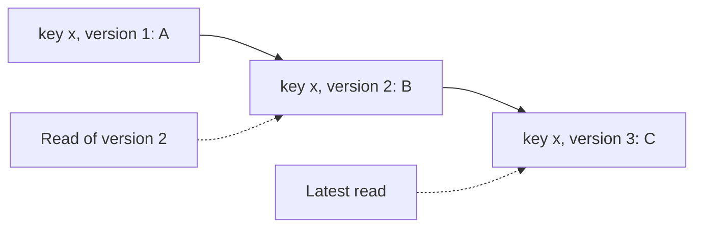

# Versioned Value

## Description

In Versioned Value, each value of a key is stored along with a version number that increases on every update. Instead of overwriting, each update creates a new entry (key plus version), so reads don't need to block writes and old values remain available.

This lets clients read the latest value, or a historical value at a specific version (*snapshot* read), and write conditionally by comparing the expected version (*compare-and-swap*). The version can come from the Replicated Log index or from a counter, and it's often ordered together with the key, which makes range scans efficient.

It appears in etcd (MVCC revisions), ZooKeeper (zxid and znode version), and Kafka (offsets).

## Problems it solves

- Nodes need to know the most recent value of a key.
- Sometimes you need to know previous values to react to changes.
- Reads shouldn't block writes or see partial states.

## When to use

- Key-value stores with consistent reads and optimistic concurrency.
- When clients watch for changes starting from a version.
- MVCC and snapshot reads.

### When to avoid

- Data where history isn't needed and space is critical.
- Simple single-client storage with no concurrency.

## Trade-offs

| Benefit | Cost / Risk |
| --- | --- |
| Non-blocking reads and reading of historical versions | More storage and the need to compact old versions |
| Conditional writes avoid lost updates | Conflicts require the client to retry |
| Foundation for change watching and snapshots | Version management adds storage complexity |

- **Compaction:** discard old versions according to a policy, such as the Low-Water Mark.
- **Global version:** in replicated stores, use the log index as the version.

## Diagram

Each update creates a new version of the key, making it possible to read the latest value or a historical version.

## Related patterns

- [Replicated Log](/architecture/distributed-systems/data-replication/replicated-log) — the log index can serve as the version
- [Follower Reads](/architecture/distributed-systems/data-replication/follower-reads) — the version enables reads with a minimum guarantee on followers
- [Version Vector](/architecture/distributed-systems/data-replication/version-vector) — per-node version to detect concurrency
- [Optimistic Offline Lock](/application/poeaa/offline-concurrency/optimistic-offline-lock) — optimistic concurrency control with a version number

## Reference

- [Pattern page in the Patterns of Distributed Systems catalog](https://martinfowler.com/articles/patterns-of-distributed-systems/versioned-value.html)
