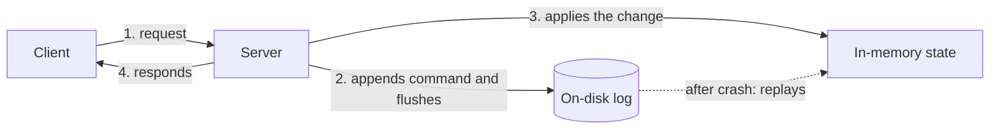

# Write-Ahead Log

## Description

The Write-Ahead Log (WAL) is an append-only log file on disk in which every state change is recorded as a command before it's applied to the in-memory data structures or the data files. Only after the record has been written (and synced to disk, via *flush*/`fsync`) does the server apply the change and respond to the client. That's why the log is also called the *commit log*.

If the server crashes and restarts, it has lost its in-memory state, but not the log. During recovery, the node reads the log from the beginning (or from the last checkpoint) and re-executes the commands in order, rebuilding the exact state from before the failure. Each entry usually has a sequential identifier (index), the data type, and the command's content, and often a checksum to detect partial writes.

The pattern is the foundation of several others in the catalog: the Segmented Log splits the log into smaller files, the Low-Water Mark discards what's no longer needed, and the Replicated Log replicates it across nodes. It appears in Cassandra (commit log), ZooKeeper (transaction log), etcd (WAL with Raft), and Kafka, whose storage is essentially a partitioned log.

## Problems it solves

- Guaranteeing durability: once the server has accepted an action, it must be completed even if the server fails and restarts without its in-memory state.
- Avoiding costly random writes to data structures on the critical path, replacing them with sequential appends.
- Making it possible to rebuild state after a crash by re-executing the recorded commands.
- Giving every change a total order and an identifier, which underpins replication and recovery.

## When to use

- Databases, brokers, and coordination services that keep state in memory or in complex structures and must survive restarts.
- When the sequence of changes needs to be replicated to other nodes, as the foundation of a Replicated Log.
- When the durability of every acknowledged write is a requirement (for example, with `fsync` before the *ack*).

## When to avoid

- Ephemeral or easily recreated data (caches), where losing state in a crash is acceptable.
- When the latency of `fsync` on every write is unacceptable and losing a recent window of data is tolerated.
- Systems that already delegate durability to a reliable external store, making the log redundant.

## Trade-offs

| Benefit | Cost / Risk |
| --- | --- |
| Strong durability and deterministic recovery after failures | Every write pays the cost of an append and `fsync` to disk, which limits throughput and adds latency |
| Sequential writes, fast on disks and SSDs | The log grows without bound and requires segmentation and cleanup (Segmented Log and Low-Water Mark) |
| Total order of changes, useful for replication | Slow recovery if the log is long and there are no *snapshots* or checkpoints |

- **Partial writes:** use per-entry checksums to discard the corrupted tail during recovery.
- **Flush policy:** syncing on every write is safe and slow; batching writes (*group commit*) or syncing periodically trades durability for performance.
- **Concurrency:** sequential writing is usually done by a single thread, as in the Singular Update Queue.
- **Idempotency:** since replay may repeat commands, commands must be safe to reapply.

## Diagram

The server writes the command to the log on disk before changing the in-memory state, and only then responds. After a failure, the state is rebuilt by replaying the log.

## Related patterns

- [Segmented Log](/architecture/distributed-systems/data-replication/segmented-log) — splits the log into several files to make reading and cleanup easier
- [Low-Water Mark](/architecture/distributed-systems/data-replication/low-water-mark) — defines how far back the log can be discarded
- [Replicated Log](/architecture/distributed-systems/data-replication/replicated-log) — replicates the WAL across nodes to form a consistent log
- [Singular Update Queue](/architecture/distributed-systems/data-replication/singular-update-queue) — serializes writes to the log on a single thread
- [Generation Clock](/architecture/distributed-systems/data-replication/generation-clock) — the generation is written to every log entry
- [Event Sourcing](/architecture/cloud-design-patterns/data-management/event-sourcing) — also stores state as a sequence of events in an immutable log
- [Transaction Log Tailing](/architecture/microservices/transactional-messaging/transaction-log-tailing) — reads the database's transaction log, which is a WAL, to publish events

## Reference

- [Pattern page in the Patterns of Distributed Systems catalog](https://martinfowler.com/articles/patterns-of-distributed-systems/write-ahead-log.html)
