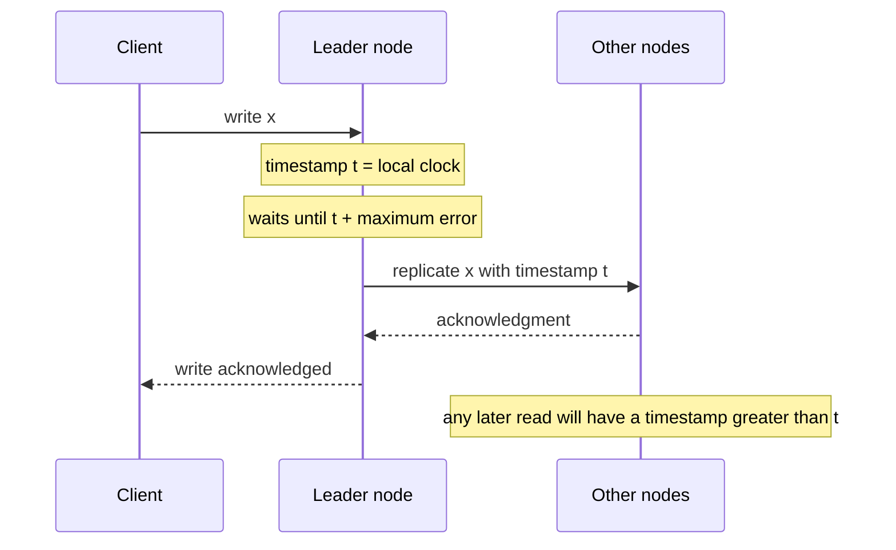

# Clock-Bound Wait

## Description

Clock-Bound Wait deals with the uncertainty of physical clocks in a cluster by waiting for it to pass. Given an upper bound on the difference between node clocks, the node that assigns a timestamp to a write (or reads a value) waits until all clocks in the cluster are guaranteed to be past that timestamp before proceeding.

For example, if the maximum clock skew is 10 ms, a write with timestamp t only becomes visible after t plus 10 ms. From then on, any node, even one with a lagging clock, will assign reads timestamps greater than the write's and will see it.

The smaller and better known the error bound, the shorter the wait. That's why the pattern is usually associated with high-precision time infrastructure, such as atomic clocks and GPS, or with synchronization services that expose the maximum error. Databases like Spanner, CockroachDB, and YugabyteDB apply variations of this idea.

## Problems it solves

- In a key-value store with timestamp-based versions, a read on a node with a lagging clock may return stale data, even after the write has been acknowledged on another node.
- Two clients querying different nodes see a different "latest" value, violating external consistency.
- Asking a server for the latest version requires an extra round trip and, for several keys, querying each one.
- Clocks that run ahead make writes appear to be in the future.
- Lamport and Hybrid Clock give only a partial order: events with no causal relationship on different nodes aren't ordered.

## When to use

- You need external consistency (an order consistent with the real time observed by clients) across different nodes.
- A small, known clock error bound exists, so the wait is acceptable.
- The system uses timestamps as versions in a distributed multi-version store.

## When to avoid

- The clock error bound is unknown or large; the wait gets long or, worse, the bound is violated and the guarantee is lost.
- Write or read latency is critical and the uncertainty isn't small.
- Causal order is enough, in which case a Lamport Clock or a Hybrid Clock suffices.

## Trade-offs

| Benefit | Cost / Risk |
| --- | --- |
| External consistency without querying a central ordering service | Extra latency on every write or read, proportional to the uncertainty |
| Reads on any node see writes that have already been acknowledged | Depends on a reliable error bound |
| Avoids a round trip to discover the latest version | If the bound is underestimated, the guarantee is silently violated |

- The cost drops when clocks are well synchronized, but grows with drift.
- Some systems, instead of always waiting, restart the read when they find a value inside the uncertainty window.
- You need to monitor clock error and remove nodes that exceed the bound from the cluster.

## Diagram

The write is only acknowledged after local time passes t plus the maximum error, guaranteeing that no clock in the cluster is still before t.

## Related patterns

- [Hybrid Clock](/architecture/distributed-systems/distributed-time/hybrid-clock) — provides the timestamps the wait is applied to
- [Lamport Clock](/architecture/distributed-systems/distributed-time/lamport-clock) — causal order without physical time, which Clock-Bound Wait complements
- [Versioned Value](/architecture/distributed-systems/data-replication/versioned-value) — timestamp-versioned values that need this guarantee
- [Two-Phase Commit](/architecture/distributed-systems/data-partitioning/two-phase-commit) — transactions across partitions choose the commit timestamp and can wait out the uncertainty
- [Version Vector](/architecture/distributed-systems/data-replication/version-vector) — alternative approach that detects concurrency without relying on clocks
- [Message Sequence](/architecture/eip/message-construction/message-sequence) (EIP) — ordering at the message level
- [Resequencer](/architecture/eip/message-routing/resequencer) (EIP) — reorders messages by sequence

## Reference

- [Pattern page in the Patterns of Distributed Systems catalog](https://martinfowler.com/articles/patterns-of-distributed-systems/clock-bound-wait.html)
