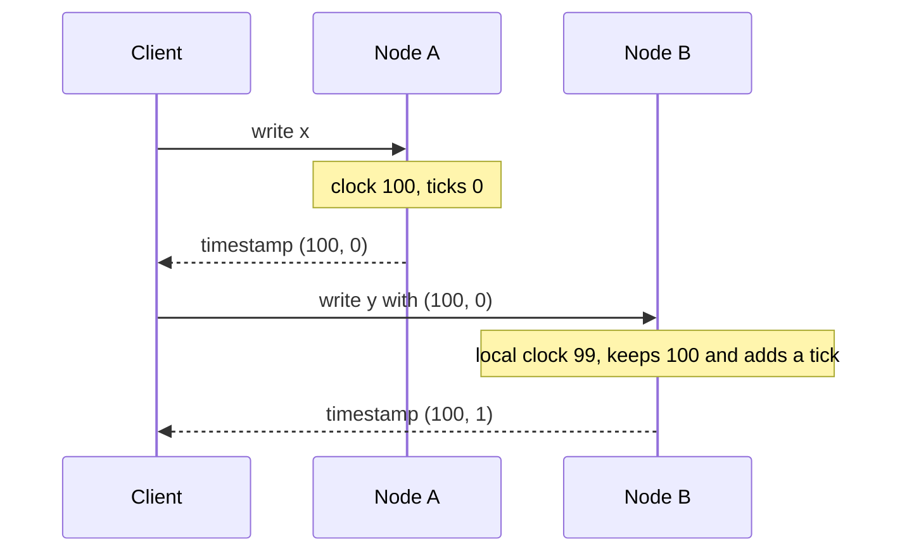

# Hybrid Clock

## Description

Hybrid Clock (hybrid logical clock, or HLC) combines the system's wall clock with a logical counter. The timestamp is a pair: the physical time and a number of ticks that breaks ties between events that occur at the same physical instant.

Comparison is done first by physical time and, in case of a tie, by ticks. When the system clock advances, the counter resets to zero; when the clock doesn't advance or is behind a received timestamp, the node keeps the highest known time and increments the ticks. This way the value never goes backward, even if the physical clock is adjusted backward.

The result behaves like a Lamport Clock, with ever-increasing versions consistent with causality, but with the advantage that the values stay close to real time. This lets clients query data "up to" a given instant and read history by date.

## Problems it solves

- Integer versions from a Lamport Clock don't tell clients when a value was written.
- Clients prefer versions that relate to date and time, but wall clocks alone are neither monotonic nor comparable across nodes.
- Several writes can occur at the same physical instant and still need a deterministic total order.

## When to use

- Versioned values need causal order and also a relationship with real time, for example for point-in-time queries or expiration.
- The system does multi-version concurrency control and needs comparable read and write timestamps.
- Node clocks are reasonably synchronized (NTP), with no specialized hardware.

## When to avoid

- Ordering by causality is enough, with no relationship to real time; a Lamport Clock is simpler.
- If strict external consistency is needed across nodes with diverging clocks, HLC alone isn't enough: it gives only a partial order between events with no causal relationship, and it must be combined with a Clock-Bound Wait.
- Detecting concurrent writes is the main goal; use a Version Vector.

## Trade-offs

| Benefit | Cost / Risk |
| --- | --- |
| Increasing, causal versions close to real time | Larger timestamp (physical time plus counter) than an integer |
| Tolerates clocks that go backward without the version regressing | A clock that's far ahead pulls the logical time of the whole cluster forward |
| No dedicated time hardware | Events with no causal relationship on different nodes are only partially ordered |

- Logical time can drift away from physical time if some node has a clock far ahead; it's wise to limit the acceptable difference.
- Makes observability easier, since versions can be correlated with times.
- Used by databases such as MongoDB and CockroachDB to version data and coordinate reads.

## Diagram

Node B's physical clock is behind, but it keeps the highest known time and increments the ticks, so the second write comes after the first.

## Related patterns

- [Lamport Clock](/architecture/distributed-systems/distributed-time/lamport-clock) — the logical foundation that Hybrid Clock extends with physical time
- [Clock-Bound Wait](/architecture/distributed-systems/distributed-time/clock-bound-wait) — complements HLC by waiting out clock uncertainty to obtain external order
- [Versioned Value](/architecture/distributed-systems/data-replication/versioned-value) — stores each value with the hybrid timestamp as its version
- [Version Vector](/architecture/distributed-systems/data-replication/version-vector) — alternative for detecting concurrent writes
- [Two-Phase Commit](/architecture/distributed-systems/data-partitioning/two-phase-commit) — transactions across partitions use timestamps as the commit time
- [Message Sequence](/architecture/eip/message-construction/message-sequence) (EIP) — ordering at the message level
- [Resequencer](/architecture/eip/message-routing/resequencer) (EIP) — reorders messages by sequence

## Reference

- [Pattern page in the Patterns of Distributed Systems catalog](https://martinfowler.com/articles/patterns-of-distributed-systems/hybrid-clock.html)
