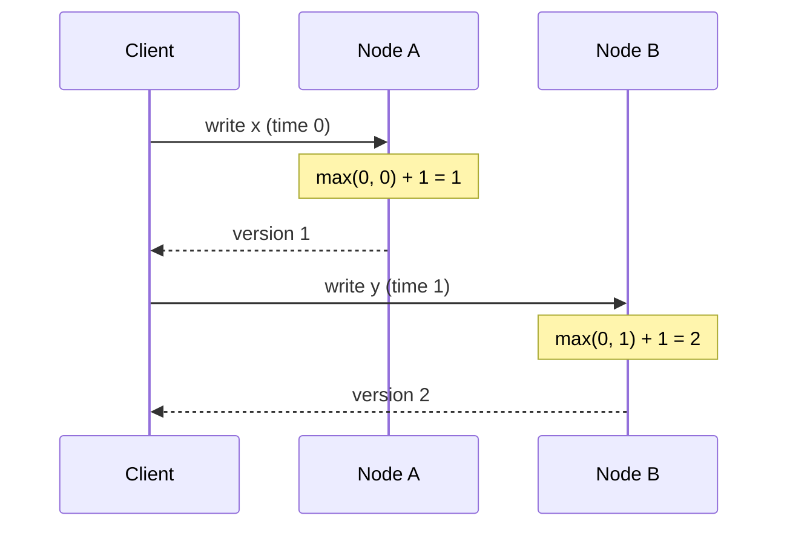

# Lamport Clock

## Description

Lamport Clock is a logical counter, a simple integer, kept by each node in the cluster to order events without relying on the wall clock. Each write increments the counter, and the resulting value serves as the write's version.

The core rule is updating based on what arrives: when receiving a request that carries a timestamp, the node adopts the larger of its local counter and the received one, and only then increments. This way the new write always comes after the request that triggered it and after everything the node had already done.

The node returns the timestamp to the client, and the client sends it on subsequent requests, even to other nodes. This passing of timestamps through the client propagates causality between different servers, with no synchronization of physical clocks.

## Problems it solves

- System clocks drift and can go backward when NTP corrects them, so they guarantee monotonicity not even on a single server.
- Drift between servers has no known bound, making it impossible to compare physical timestamps from different nodes.
- Causally related writes (for example, a write made after reading a value from another node) need to be ordered after their causes.

## When to use

- Versioned values on several nodes need an order consistent with causality.
- There are no reliable synchronized clocks, or you don't want to depend on them.
- A simple, cheap numeric version (an integer) is enough.

### When to avoid

- Clients need to relate the version to a real date and time; in that case, prefer a Hybrid Clock.
- You need to detect concurrent writes (conflicts); a single integer imposes a total order that hides concurrency, and a Version Vector is a better fit.
- Events with no observed causal relationship need to be ordered according to real time; Lamport Clock doesn't offer that.

## Trade-offs

| Benefit | Cost / Risk |
| --- | --- |
| Order consistent with causality without synchronized clocks | The number has no relationship to real time |
| Minimal state: one integer per node | Concurrent events get an arbitrary order, with no signal of the conflict |
| Trivial, cheap implementation | Depends on the client passing the timestamp along to preserve the causal chain |

- Causality is only preserved between operations linked by exchanged timestamps; independent events have no meaningful order.
- There's no way to tell, by looking at two values, whether one happened before the other or whether they were concurrent.
- Limited observability: versions are hard to correlate with logs and times.

## Diagram

The client carries the timestamp returned by node A in its request to node B, and node B adopts the larger value and increments it, guaranteeing that the second write comes after the first.

## Related patterns

- [Hybrid Clock](/architecture/distributed-systems/distributed-time/hybrid-clock) — extends the idea by combining the counter with the wall clock
- [Clock-Bound Wait](/architecture/distributed-systems/distributed-time/clock-bound-wait) — solves ordering across nodes by waiting out the uncertainty of physical clocks
- [Versioned Value](/architecture/distributed-systems/data-replication/versioned-value) — uses the logical timestamp as the version of each stored value
- [Version Vector](/architecture/distributed-systems/data-replication/version-vector) — detects concurrency, which a single integer can't
- [Generation Clock](/architecture/distributed-systems/data-replication/generation-clock) — another logical counter, used to mark leadership epochs
- [Message Sequence](/architecture/eip/message-construction/message-sequence) (EIP) — numbering messages to order them
- [Resequencer](/architecture/eip/message-routing/resequencer) (EIP) — restores message order using sequence numbers

## Reference

- [Pattern page in the Patterns of Distributed Systems catalog](https://martinfowler.com/articles/patterns-of-distributed-systems/lamport-clock.html)
