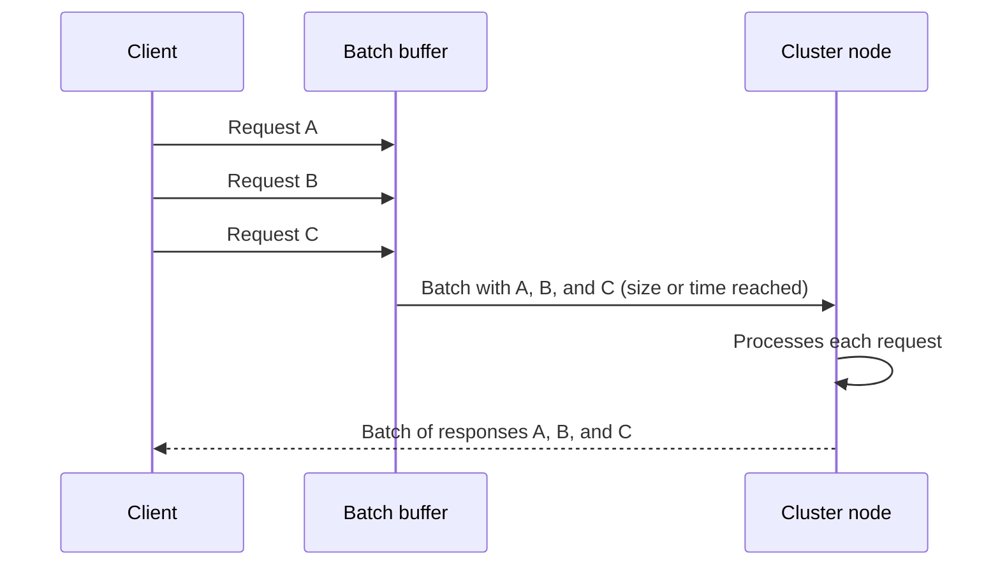

# Request Batch

## Description

Request Batch groups several small requests into a single network message and sends it to a cluster node in one go. The node processes each request in the batch just as it would individually and returns a batch of responses, usually in the same order.

The gain comes from spreading fixed per-request costs: network latency, headers, serialization and deserialization, system calls, and thread wake-ups. With requests of only a few bytes, this overhead tends to dominate total time, and the link stays underused even with many concurrent clients.

The client usually closes the batch by size (bytes or item count) or by maximum wait time, whichever comes first. Log brokers like Kafka and databases like Cassandra use this technique in producers, replication, and disk writes to increase throughput.

## Problems it solves

- Many small requests saturate processing and the network because of overhead, not data volume.
- Per-request latency limits the client's total throughput, even with bandwidth to spare.
- The server spends too much time on serialization, deserialization, and system calls for each request.

## When to use

- High volume of small requests to the same node (writes to a replicated log, message production, metadata updates).
- When it is acceptable to trade a bit of individual latency for aggregate throughput.
- Combined with [Request Pipeline](/architecture/distributed-systems/node-communication/request-pipeline), to make the most of the channel.

### When to avoid

- Low-volume or latency-sensitive workloads, where waiting to fill the batch only delays the response.
- When requests are large and already amortize the overhead well.
- When a partial failure within the batch is hard to handle or to report to the client independently.

## Trade-offs

| Benefit | Cost / Risk |
| --- | --- |
| Higher throughput and more efficient use of network and CPU | Added latency while the batch fills up |
| Less serialization and fewer system calls per request | Partial failures require item-by-item handling |
| Fewer messages for the receiving node to process | Large batches increase memory usage and resend cost |

- You need to bound both the size and the time of the batch to avoid both excessive latency and huge messages.
- Apply backpressure when the receiving node can't keep up with the batches.
- For non-idempotent operations, resending a whole batch can duplicate effects; consider [Idempotent Receiver](/architecture/cloud-design-patterns/messaging/idempotent-consumer).
- Don't confuse it with [Queue-Based Load Leveling](/architecture/cloud-design-patterns/messaging/queue-based-load-leveling), which uses a queue to smooth load spikes and decouple producer and consumer, without grouping requests for the same destination.

## Diagram

The client accumulates requests in a buffer and sends them as a single batch when it reaches the size or time limit. The node processes all of them and also responds in a batch.

## Related patterns

- [Request Pipeline](/architecture/distributed-systems/node-communication/request-pipeline) — complementary: the pipeline keeps several requests in flight, and batching reduces the cost of each one.
- [Single-Socket Channel](/architecture/distributed-systems/node-communication/single-socket-channel) — the channel batches usually travel over, preserving order.
- [Singular Update Queue](/architecture/distributed-systems/data-replication/singular-update-queue) — the receiver can drain the queue in batches for efficiency.
- [Idempotent Receiver](/architecture/cloud-design-patterns/messaging/idempotent-consumer) — protects against duplicate effects when a batch is resent.
- [Message Sequence](/architecture/eip/message-construction/message-sequence) (EIP) — splitting or grouping data into sequences of messages.
- [Queue-Based Load Leveling](/architecture/cloud-design-patterns/messaging/queue-based-load-leveling) (cloud) — contrast: levels load with a queue instead of grouping requests.

## Reference

- [Pattern page in the Patterns of Distributed Systems catalog](https://martinfowler.com/articles/patterns-of-distributed-systems/request-batch.html)
