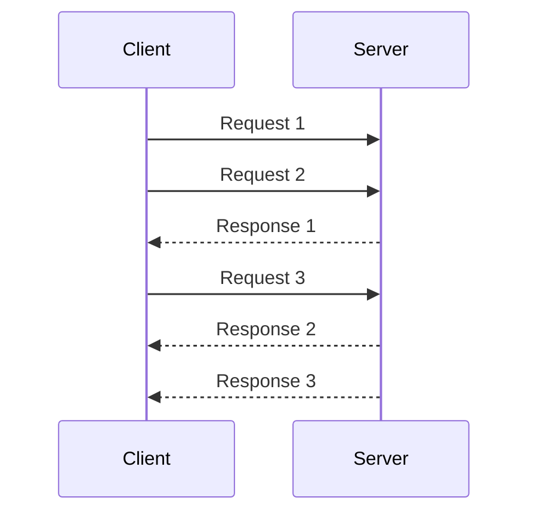

# Request Pipeline

## Description

Request Pipeline lets a node send several requests to another node without waiting for the response to each one before sending the next. Instead of a strict send-and-wait cycle, the channel always has requests in flight, and responses are consumed as they arrive.

There are usually two independent threads of execution per connection: one writes requests to the channel and the other reads the responses. A correlation mechanism matches each response to its originating request, and in a [Single-Socket Channel](/architecture/distributed-systems/node-communication/single-socket-channel), TCP ordering helps keep that matching predictable.

The gain shows up when the server can process something while other requests are still arriving, as happens with a [Singular Update Queue](/architecture/distributed-systems/data-replication/singular-update-queue). If the client sends only one request at a time, the server's and the link's capacity sit idle during each round trip. Systems like Kafka and ZooKeeper cap the number of in-flight requests per connection to balance throughput, ordering, and memory consumption.

## Problems it solves

- Waiting for the response to each request wastes server and network capacity.
- Throughput is bounded by round-trip latency rather than by the node's actual capacity.
- Server request queues stay empty when they could be kept full.

## When to use

- Replication from leader to followers, where many log entries are sent in sequence.
- Client and server connected by a single ordered channel, with significant network latency.
- When the server processes requests from a queue and benefits from always having work available.

### When to avoid

- When each request depends on the result of the previous one and can't be sent earlier.
- When reordering caused by retries could violate ordering guarantees without a control mechanism.
- When the receiver has no way to apply backpressure and could be flooded with requests.

## Trade-offs

| Benefit | Cost / Risk |
| --- | --- |
| Higher throughput and better use of the server and network | More client complexity (correlation, two threads of execution) |
| Less impact from round-trip latency | Failures leave several requests in doubt, requiring resends |
| Server queue is always fed | Risk of overload without a limit on in-flight requests |

- Set a maximum number of in-flight requests per connection to control memory and pressure on the receiver.
- Retries can reorder messages; without care, the original order is lost. Idempotent receivers help tolerate resends.
- Matching responses by identifier or by channel order makes tracking easier, for example in the [Request Waiting List](/architecture/distributed-systems/data-replication/request-waiting-list).
- Monitor the number of in-flight requests and response times.

## Diagram

The client sends requests 2 and 3 without waiting for the response to request 1. The responses arrive later and are handled by a separate thread of execution.

## Related patterns

- [Single-Socket Channel](/architecture/distributed-systems/node-communication/single-socket-channel) — provides the ordered channel the pipeline operates on.
- [Request Batch](/architecture/distributed-systems/node-communication/request-batch) — complementary: reduces the cost per request, while the pipeline reduces waiting.
- [Singular Update Queue](/architecture/distributed-systems/data-replication/singular-update-queue) — server-side queue that benefits from being always fed.
- [Request Waiting List](/architecture/distributed-systems/data-replication/request-waiting-list) — tracks in-flight requests until the responses arrive.
- [Leader and Followers](/architecture/distributed-systems/data-replication/leader-and-followers) — typical scenario of continuous sending from the leader to the followers.
- [Idempotent Receiver](/cloud/cloud-design-patterns/messaging/idempotent-consumer) — makes resends after failures safe.

## Reference

- [Pattern page in the Patterns of Distributed Systems catalog](https://martinfowler.com/articles/patterns-of-distributed-systems/request-pipeline.html)
