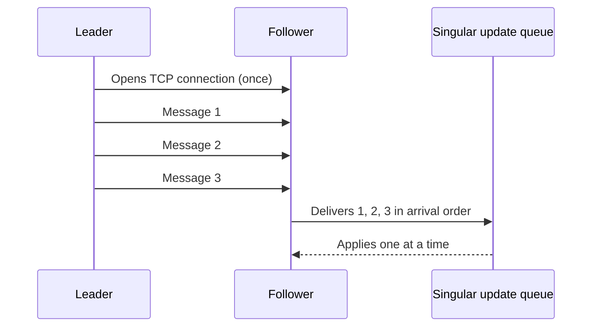

# Single-Socket Channel

## Description

Single-Socket Channel uses a single, long-lived TCP connection for all traffic between a pair of nodes, for example between a follower and its leader. Because TCP already delivers bytes in order and retransmits lost packets, messages sent over this channel arrive in the sequence they were written, without the application protocol having to reimplement those guarantees.

On the receiving node, messages read from the channel are usually handed to a singular update queue, which processes them one at a time. This turns arrival order into application order, which is essential for log replication and for updating follower state.

If the connection drops, the sender reopens it and resends whatever hasn't been acknowledged yet. Since the connection is reused, the setup cost (handshake, TLS) is paid once rather than for every message.

## Problems it solves

- Messages between leader and follower must be processed in the order they were sent.
- Messages lost on the network must be retransmitted without extra application logic.
- Opening one connection per request increases latency and resource consumption (ports, descriptors, handshakes).
- Parallel connections between the same pair of nodes can reorder related messages.

## When to use

- Continuous communication between fixed pairs of nodes, such as leader and followers in [Leader and Followers](/architecture/distributed-systems/data-replication/leader-and-followers).
- Replication flows where message order matters (replicated log, state updates).
- When you want ordering and reliable delivery delegated to TCP, instead of your own numbering and acknowledgments.

## When to avoid

- When messages are independent and order doesn't matter: multiple connections may yield more throughput.
- When a large or slow message must not block the others (head-of-line blocking) and there is no way to segment them.
- When the protocol already multiplexes independent streams (for example, stream-based protocols), making a single channel redundant.

## Trade-offs

| Benefit | Cost / Risk |
| --- | --- |
| Ordering and reliable delivery provided by TCP | Head-of-line blocking: one slow message delays all the ones after it |
| Connection cost paid once and reused | A dropped connection requires reconnecting and resending what wasn't acknowledged |
| Simple model for reasoning about order | A single channel can limit throughput on high-latency links |

- Ordering holds per channel: if the node switches connections, you must ensure old messages aren't processed after new ones.
- It's common to combine the channel with [Heartbeat](/architecture/distributed-systems/data-replication/heartbeat) to detect dead connections.
- Observability is simple, since there is one connection per pair of nodes to monitor.

## Diagram

The leader opens a single connection to the follower and sends all messages over it. The follower receives them in order and hands them to a queue that applies them sequentially.

## Related patterns

- [Leader and Followers](/architecture/distributed-systems/data-replication/leader-and-followers) — the context in which the single channel links the leader to each follower.
- [Singular Update Queue](/architecture/distributed-systems/data-replication/singular-update-queue) — serializes, at the receiver, the messages arriving over the channel.
- [Heartbeat](/architecture/distributed-systems/data-replication/heartbeat) — travels over the same channel and helps detect connection failures.
- [Request Pipeline](/architecture/distributed-systems/node-communication/request-pipeline) — allows sending several requests over the channel without waiting for each response.
- [Request Batch](/architecture/distributed-systems/node-communication/request-batch) — groups requests to reduce the per-message cost on the channel.
- [Guaranteed Delivery](/architecture/eip/messaging-channels/guaranteed-delivery) (EIP) — messaging-level delivery guarantee, comparable to TCP's reliability.

## Reference

- [Pattern page in the Patterns of Distributed Systems catalog](https://martinfowler.com/articles/patterns-of-distributed-systems/single-socket-channel.html)
