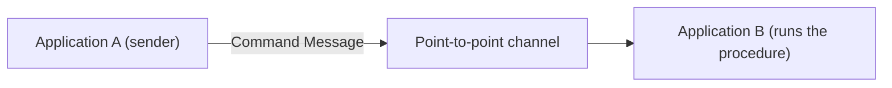

# Command Message

## Description

Command Message is a regular message whose content is an order: it asks another application to execute a procedure. It's a way to get the effect of a remote call using messaging, with the reliability and decoupling the channel provides.

There's no special message type for this. The command can be an object, structured text, or a SOAP request; what defines it is the intent to trigger an action in the receiver.

## Problems it solves

- An application needs to invoke functionality in another one, but prefers the benefits of messaging over a synchronous remote call.
- The invoker shouldn't fail just because the receiver is temporarily unavailable.
- The invocation must be reliably delivered to a single executor.

## When to use

- When an application needs another one to perform an action and the execution can be asynchronous.
- When you want to queue work and absorb load spikes.
- Usually on a point-to-point channel, so that only one receiver executes the command.

### When to avoid

- When the caller needs the result immediately and can't tolerate waiting.
- When all you want is to report that something happened (use Event Message).
- When the intent is to transfer data without dictating what the receiver will do (use Document Message).

## Trade-offs

| Benefit | Cost / Risk |
| --- | --- |
| Invocation delivered reliably and asynchronously | The result isn't immediate; requires Request-Reply if a response is needed |
| An unavailable receiver doesn't take the sender down | Semantic coupling: the sender knows the receiver's operation |
| Work can be queued and balanced | Redelivery can duplicate execution if the receiver isn't idempotent |

- Commands should be handled idempotently when redelivery can occur.
- Execution errors need their own path (a reply or an invalid message channel).

## Diagram

Application A sends a command over a channel, and application B executes it when it receives it.

## Related patterns

- [Message](/architecture/eip/message-construction/message) — the command is a message
- [Document Message](/architecture/eip/message-construction/document-message) — carries data instead of ordering an action
- [Event Message](/architecture/eip/message-construction/event-message) — notifies a fact instead of requesting an action
- [Request-Reply](/architecture/eip/message-construction/request-reply) — used when the command needs a reply
- [Point-to-Point Channel](/architecture/eip/messaging-channels/point-to-point-channel) — guarantees a single executor
- [Command](/coding/gof/behavioral/command) — GoF pattern that encapsulates a request as an object

## Reference

- [Pattern page on Enterprise Integration Patterns](https://www.enterpriseintegrationpatterns.com/CommandMessage.html)
