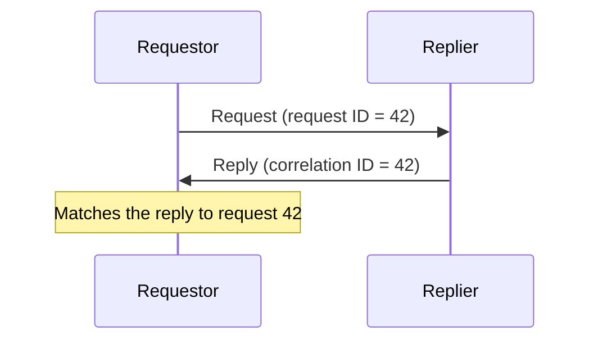

# Correlation Identifier

## Description

Correlation Identifier lets the requestor know which request a reply refers to. Each request carries a unique identifier; the replier copies that value into the reply as the correlation identifier.

When it receives the reply, the requestor compares the correlation identifier with the identifiers of the requests it sent and matches each reply to its context. The elements are: requestor, replier, request, reply, request ID, and correlation ID.

## Problems it solves

- In asynchronous messaging, several requests are in flight at the same time.
- Replies can arrive out of order.
- The requestor needs to link each reply to the original request to resume its context.

## When to use

- In any Request-Reply with more than one pending request.
- In multi-step flows, to group messages belonging to the same conversation.
- To trace a transaction across components.

## When to avoid

- When there's only one pending request per reply channel and ordering is guaranteed.
- When there's no reply to correlate.

## Trade-offs

| Benefit | Cost / Risk |
| --- | --- |
| Replies are matched correctly, even out of order | The requestor must keep the state of pending requests |
| Enables concurrency and asynchronous callbacks | The replier must always copy the identifier |
| Foundation for conversation tracking | Duplicated or lost identifiers break the matching |

- Generate unique identifiers (for example, a UUID).
- Propagate the identifier in logs to make investigation easier.

## Diagram

The replier returns the same identifier, and the requestor uses it to find the original request.

## Related patterns

- [Request-Reply](/architecture/eip/message-construction/request-reply) — main context of use
- [Return Address](/architecture/eip/message-construction/return-address) — says where to reply, while the identifier says which request it answers
- [Message Sequence](/architecture/eip/message-construction/message-sequence) — also uses identifiers to group messages
- [Message](/architecture/eip/message-construction/message) — the identifier lives in the header
- [Distributed Tracing](/architecture/microservices/observability/distributed-tracing) — propagates identifiers to trace calls across services

## Reference

- [Pattern page on Enterprise Integration Patterns](https://www.enterpriseintegrationpatterns.com/CorrelationIdentifier.html)
