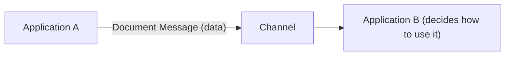

# Document Message

## Description

Document Message carries a data structure from one application to another. Unlike a command, it doesn't tell the receiver what to do: it delivers the data and leaves the decision about how to use it to whoever receives it.

The document is treated as a unit, even if it contains smaller parts. What matters is that it arrives reliably; the exact moment of arrival is usually less critical.

## Problems it solves

- Transferring data between applications without the limitations of File Transfer and Shared Database.
- Keeping the sender from needing to know what the receiver will do with the data.
- Ensuring that a data structure arrives intact.

## When to use

- To replicate or distribute data (orders, records, results) across systems.
- When the receiver should decide how to process the content.
- When reliable delivery matters more than latency, combined with Guaranteed Delivery.

### When to avoid

- When you need to order a specific action (use Command Message).
- When all that matters is signaling that something happened and timing is critical (use Event Message).
- When the document is too large; consider Claim Check or Message Sequence.

## Trade-offs

| Benefit | Cost / Risk |
| --- | --- |
| Sender decoupled from how the receiver uses the data | The receiver must understand the document's structure |
| Reliable delivery of complete data | Large documents weigh on the channel |
| Easy to combine with Guaranteed Delivery | Format evolution requires care with compatibility |

- Implicit intent can create ambiguity; name the document type well.
- To reduce message weight, send a reference to the data instead of the data itself.

## Diagram

Application A sends the data, and application B decides what to do with it.

## Related patterns

- [Message](/architecture/eip/message-construction/message) — the document is the message body
- [Command Message](/architecture/eip/message-construction/command-message) — requests an action instead of delivering data
- [Event Message](/architecture/eip/message-construction/event-message) — notifies a fact; the content matters less
- [Request-Reply](/architecture/eip/message-construction/request-reply) — the reply is often a document
- [Guaranteed Delivery](/architecture/eip/messaging-channels/guaranteed-delivery) — ensures the document arrives
- [Claim Check](/cloud/cloud-design-patterns/messaging/claim-check) — alternative for large documents

## Reference

- [Pattern page on Enterprise Integration Patterns](https://www.enterpriseintegrationpatterns.com/DocumentMessage.html)
