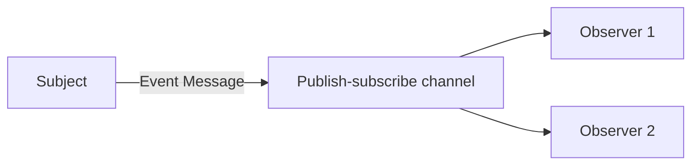

# Event Message

## Description

Event Message is a message that asynchronously notifies that something happened. The subject packages the event in a message and publishes it to a channel; the observer receives it, extracts the event, and reacts.

The focus is on the fact that the event occurred, not on the volume of data. Many events don't even carry content: the mere arrival of the message already signals the observer that it should act. That's why timing matters: the event should be published promptly and processed while it's still relevant.

## Problems it solves

- Applications need to coordinate actions by reacting to each other's changes.
- Avoiding tight coupling between whoever changes state and whoever needs to know about it.
- Delivering low-latency notifications to one or several observers.

## When to use

- To notify state changes to interested observers.
- With a publish-subscribe channel, when several consumers react to the same event.
- With Message Expiration, when old events lose their usefulness.

## When to avoid

- When the receiver needs to receive complete, reliable data (use Document Message).
- When you want to command a specific action (use Command Message).
- When every event must be delivered without loss; frequent, time-sensitive events rarely justify Guaranteed Delivery, but if loss is unacceptable, reconsider.

## Trade-offs

| Benefit | Cost / Risk |
| --- | --- |
| Low coupling between subject and observers | Hard to know who reacts to each event |
| Fast, asynchronous notification | Lost or delayed events can leave observers out of date |
| Easy to add new observers | A distributed business flow is harder to trace |

- Small events require the observer to query the source for details.
- Define an expiration to discard obsolete events.

## Diagram

The subject publishes the event once, and each observer receives it and reacts.

## Related patterns

- [Message](/architecture/eip/message-construction/message) — the event is carried as a message
- [Document Message](/architecture/eip/message-construction/document-message) — used when the content matters more than the timing
- [Command Message](/architecture/eip/message-construction/command-message) — requests an action instead of reporting a fact
- [Message Expiration](/architecture/eip/message-construction/message-expiration) — discards events that are no longer valid
- [Publish-Subscribe Channel](/architecture/cloud-design-patterns/messaging/publisher-subscriber) — delivers the event to several observers
- [Guaranteed Delivery](/architecture/eip/messaging-channels/guaranteed-delivery) — rarely suitable for frequent events
- [Domain Event](/architecture/microservices/service-collaboration/domain-event) — domain event published between services

## Reference

- [Pattern page on Enterprise Integration Patterns](https://www.enterpriseintegrationpatterns.com/EventMessage.html)
