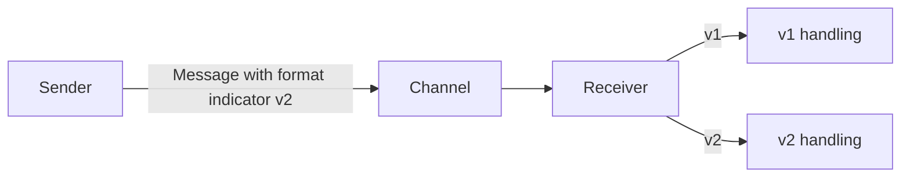

# Format Indicator

## Description

Format Indicator adds a marker to each message that identifies the format of its data. The receiver reads the marker to know how to interpret the content, which allows handling several formats at once and evolving the format without breaking participants.

There are three ways to build the marker: a version number, which both sides must know how to interpret; a foreign key (file name, database key, or URL) pointing to a format document; or a format document embedded in the message itself, for example a schema, in which case both sides must agree on the schema language.

## Problems it solves

- The data format, even a canonical model, will change over time.
- Senders and receivers evolve at different paces and need to keep understanding each other.
- A receiver may need to accept more than one version at the same time.

## When to use

- When the message format is likely to change.
- When several versions of senders and receivers coexist.
- In long-lived integrations with independent deployment cycles.

### When to avoid

- When the format is fixed and all participants are updated together.
- When evolution can be handled with compatible optional fields alone, without identifying versions.

## Trade-offs

| Benefit | Cost / Risk |
| --- | --- |
| Format evolution without breaking consumers | Receivers must keep supporting several versions |
| The receiver picks the correct handling | The meaning of the indicator must be agreed upon |
| An embedded document removes the need for an external lookup | Larger messages with an embedded schema |

- Old versions should have a deprecation policy.
- Use a Message Translator to convert old versions to the current one.

## Diagram

The receiver reads the format indicator and picks the appropriate handling.

## Related patterns

- [Message](/architecture/eip/message-construction/message) — the indicator goes in the header
- [Canonical Data Model](/architecture/eip/message-transformation/canonical-data-model) — common format whose evolution the indicator makes possible
- [Message Translator](/architecture/eip/message-transformation/message-translator) — converts between format versions
- [Document Message](/architecture/eip/message-construction/document-message) — documents often require versioning

## Reference

- [Pattern page on Enterprise Integration Patterns](https://www.enterpriseintegrationpatterns.com/FormatIndicator.html)
