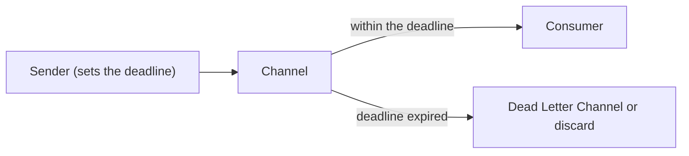

# Message Expiration

## Description

Message Expiration lets the sender define how long a message remains valid. If it isn't consumed within the deadline, it expires, and consumers ignore it as if it had never been sent.

Many systems route expired messages to a Dead Letter Channel; others simply discard them, sometimes by configuration. A receiver that realizes it can't finish processing before the deadline should also discard the message.

## Problems it solves

- Messages that are only useful if processed quickly.
- Processing obsolete data or requests wastes resources and can produce wrong results.
- Destinations with limited throughput accumulate queues of messages that have already lost their value.

## When to use

- Requests or data that lose their value after a deadline.
- Rate-limited destinations, such as HTTP endpoints, where the backlog grows.
- To avoid acting on outdated instructions.

## When to avoid

- When every message must be processed, no matter how late.
- When subscribers that join later need to receive old messages; in that case prefer longer retention or durable subscriptions.

## Trade-offs

| Benefit | Cost / Risk |
| --- | --- |
| Avoids processing obsolete messages | Useful messages can be lost if the deadline is too short |
| Reduces backlog and processing cost | Choosing between discarding and dead-lettering affects recovery |
| Protects slow destinations | Unsynchronized clocks distort the deadline |

- In general, the earlier deadline between the message and the queue prevails.
- Monitor the volume of expired messages as a signal of slow consumers.

## Diagram

Messages within the deadline go to the consumer; expired ones are discarded or diverted.

## Related patterns

- [Dead Letter Channel](/architecture/eip/messaging-channels/dead-letter-channel) — common destination for expired messages
- [Invalid Message Channel](/architecture/eip/messaging-channels/invalid-message-channel) — destination for messages the receiver can't handle
- [Guaranteed Delivery](/architecture/eip/messaging-channels/guaranteed-delivery) — the opposite concern: not losing messages
- [Publish-Subscribe Channel](/architecture/cloud-design-patterns/messaging/publisher-subscriber) — late subscribers may need old messages
- [Event Message](/architecture/eip/message-construction/event-message) — obsolete events are good candidates for expiration
- [Request-Reply](/architecture/eip/message-construction/request-reply) — expired requests shouldn't be served
- [Message](/architecture/eip/message-construction/message) — the deadline goes in the header

## Reference

- [Pattern page on Enterprise Integration Patterns](https://www.enterpriseintegrationpatterns.com/MessageExpiration.html)
