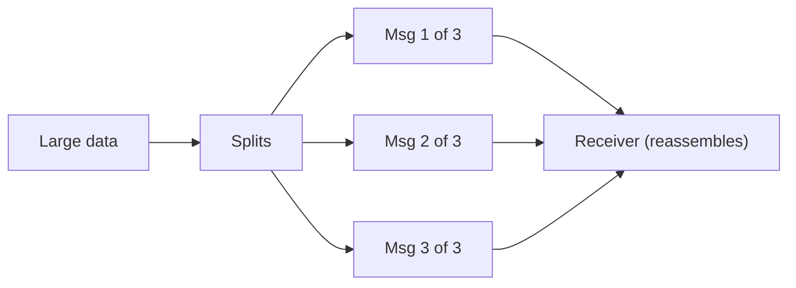

# Message Sequence

## Description

Message Sequence handles data too large to fit in a single message. The data is split into message-sized pieces and sent as a sequence.

Each message carries three fields: a sequence identifier, which groups the messages of the same set; a position identifier, which orders the message within the set; and the total size or an end marker on the last message. The receiver uses these fields to reassemble the original data.

## Problems it solves

- Sending an arbitrarily large amount of data through messaging.
- Returning a reply too large for a single message.
- Letting the receiver know when it has received the complete set.

## When to use

- When the payload exceeds the messaging system's size limit.
- When a reply to a request needs to be fragmented.
- When the data can be processed and reassembled in parts.

## When to avoid

- When the data can be stored in a data store and only a reference sent (Claim Check).
- When the infrastructure can't guarantee ordering and completeness and there's no way to reassemble.

## Trade-offs

| Benefit | Cost / Risk |
| --- | --- |
| Transfers data of any size | The receiver must reassemble and deal with missing messages |
| Each message is small and quick to send | Ordering and completeness require explicit control |
| Allows processing in parts | Competing consumers complicate reassembly |

- Gather the parts of a sequence at the same consumer, or use a Resequencer.
- Define what to do if a part never arrives, for example with expiration.

## Diagram

The data is split into numbered messages within the same sequence, and the receiver reassembles them.

## Related patterns

- [Splitter](/architecture/eip/message-routing/splitter) — splits one message into several
- [Resequencer](/architecture/eip/message-routing/resequencer) — restores message order
- [Aggregator](/architecture/eip/message-routing/aggregator) — combines related messages into one
- [Claim Check](/architecture/cloud-design-patterns/messaging/claim-check) — alternative that sends only a reference to the data
- [Correlation Identifier](/architecture/eip/message-construction/correlation-identifier) — also groups messages by identifier
- [Request-Reply](/architecture/eip/message-construction/request-reply) — the reply can come as a sequence
- [Sequential Convoy](/architecture/cloud-design-patterns/messaging/sequential-convoy) — processes related messages in order on Azure

## Reference

- [Pattern page on Enterprise Integration Patterns](https://www.enterpriseintegrationpatterns.com/MessageSequence.html)
