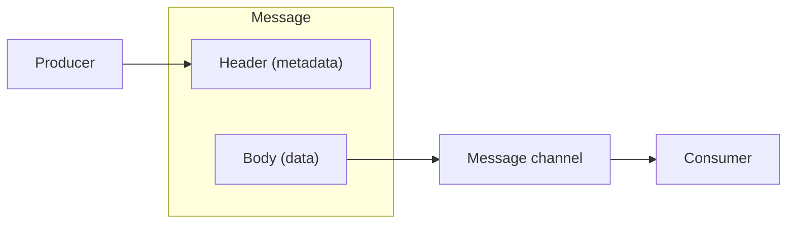

# Message

## Description

Message is the basic unit of exchange in messaging-based integration: a data record that the messaging system knows how to transport over a channel. Any information two applications need to share must be packaged into one or more messages before being sent.

A message has two parts. The header carries metadata used by the infrastructure, such as origin, destination, and the type of the data. The body carries the data itself, which the messaging system generally doesn't inspect and delivers unchanged.

## Problems it solves

- Applications connected by a channel need a common format to exchange information.
- The infrastructure needs routing metadata without interpreting the business content.
- Business data must travel intact between producer and consumer.

## When to use

- Whenever two applications communicate through a message channel.
- When you want to separate transport metadata from business content.

## When to avoid

- When a direct synchronous call solves the case and there's no need for temporal decoupling.
- For very large volumes of data that don't fit in a message; in that case use a message sequence or a reference to the data.

## Trade-offs

| Benefit | Cost / Risk |
| --- | --- |
| Decoupling between producer and consumer | The body's format and semantics must be agreed upon |
| Metadata separated from content makes routing easier | Poorly defined headers create hidden coupling |
| Uniform transport regardless of the data | Size limits require fragmentation or a reference |

- Converting domain data into messages and back adds serialization cost.
- Standardizing headers (identifiers, expiration, format) improves observability.

## Diagram

The producer packages the data into a message with a header and a body and sends it over a channel to the consumer.

## Related patterns

- [Message Channel](/architecture/eip/messaging-channels/message-channel) — the path messages travel through
- [Command Message](/architecture/eip/message-construction/command-message) — message that requests an action
- [Document Message](/architecture/eip/message-construction/document-message) — message that carries data
- [Event Message](/architecture/eip/message-construction/event-message) — message that notifies an occurrence
- [Request-Reply](/architecture/eip/message-construction/request-reply) — paired message exchange
- [Message Sequence](/architecture/eip/message-construction/message-sequence) — splits large data into several messages
- [Message Expiration](/architecture/eip/message-construction/message-expiration) — limits the message's validity
- [Canonical Data Model](/architecture/eip/message-transformation/canonical-data-model) — common format for the body

## Reference

- [Pattern page on Enterprise Integration Patterns](https://www.enterpriseintegrationpatterns.com/Message.html)
