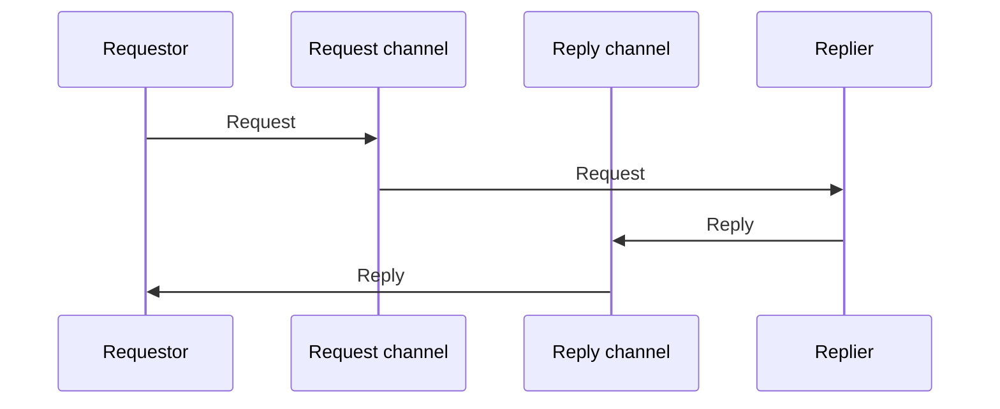

# Request-Reply

## Description

Messaging is naturally one-way. Request-Reply handles the case where the sender needs a reply by using a pair of messages, each on its own channel: the requestor sends the request over a request channel and the replier returns the reply over a reply channel.

The request channel can be point-to-point (a single consumer serves it) or publish-subscribe. The reply channel is almost always point-to-point, since only the requestor should receive it. The requestor can wait synchronously, blocking the thread, or asynchronously, with a callback triggered by another thread.

Note: don't confuse it with Azure's Asynchronous Request-Reply, which uses HTTP 202 and status polling. Here the reply arrives over a second message channel.

## Problems it solves

- The sender of a message needs to receive a reply from the receiver.
- Keeping messaging's decoupling even in question-and-answer interactions.
- Allowing several in-flight requests to share the same reply channel.

## When to use

- When an operation over messages needs to return a result to the requester.
- Synchronous wait: simple cases, with one pending request at a time.
- Asynchronous wait: several concurrent requests, or a need to recover from requestor failures.

### When to avoid

- When there's no reply to return; Command Message or Event Message is enough.
- When the requestor can't be coupled to the replier's response time.

## Trade-offs

| Benefit | Cost / Risk |
| --- | --- |
| Reply obtained without losing the channel's decoupling | Two channels and message correlation to manage |
| Asynchronous callback allows concurrency and recovery | Restoring the caller's context in the callback takes effort |
| Synchronous wait is simple | A blocked thread is hard to restore if the requestor crashes |

- Requires a Correlation Identifier to match replies to requests.
- Requires a Return Address when the reply destination varies per request.
- Define expiration and a timeout so you don't wait indefinitely.

## Diagram

The requestor sends the request over one channel and receives the reply over another.

## Related patterns

- [Return Address](/architecture/eip/message-construction/return-address) — tells the replier where to reply
- [Correlation Identifier](/architecture/eip/message-construction/correlation-identifier) — links each reply to its request
- [Command Message](/architecture/eip/message-construction/command-message) — the request is often a command
- [Document Message](/architecture/eip/message-construction/document-message) — the reply is often a document
- [Message Expiration](/architecture/eip/message-construction/message-expiration) — avoids requests that missed their deadline
- [Point-to-Point Channel](/architecture/eip/messaging-channels/point-to-point-channel) — typical reply channel
- [Asynchronous Request-Reply](/cloud/cloud-design-patterns/messaging/asynchronous-request-reply) — Azure variant based on HTTP 202 and polling, different from EIP's channel pair

## Reference

- [Pattern page on Enterprise Integration Patterns](https://www.enterpriseintegrationpatterns.com/RequestReply.html)
