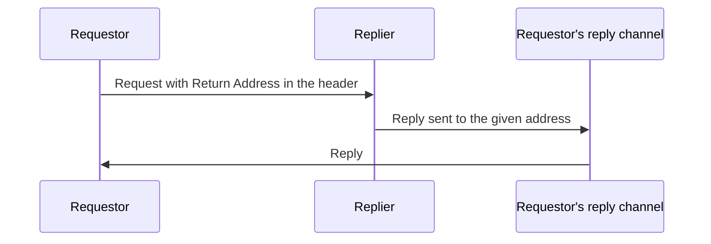

# Return Address

## Description

Return Address has the requestor indicate, in the request message itself, where the reply should be sent. Since it's routing information and not business data, the address goes in the header.

The replier reads the address from each request and replies to it, without needing to know the reply destinations in advance. The knowledge of which channels to use stays with the requestor.

## Problems it solves

- The replier shouldn't have reply destinations hard-coded.
- Different requests may require replies in different places.
- The requestor should be the one deciding the reply channels.

## When to use

- In Request-Reply where several requestors use the same replier.
- When a single requestor wants to receive replies on different channels depending on the case.

## When to avoid

- When all replies always go to a single known destination; a fixed channel is enough.
- When there's no reply to send.

## Trade-offs

| Benefit | Cost / Risk |
| --- | --- |
| Generic replier, reusable by many requestors | The replier comes to trust a destination supplied by the message |
| The requestor controls where it receives replies | Invalid or stale addresses cause lost replies |
| No destination configuration in the replier | Requires creating and managing reply channels |

- Validate or restrict the accepted addresses, to avoid redirecting replies to improper destinations.
- Combine with Correlation Identifier to match the reply to the request.

## Diagram

The replier replies on the channel indicated by the request header.

## Related patterns

- [Request-Reply](/architecture/eip/message-construction/request-reply) — pattern that depends on a reply destination
- [Correlation Identifier](/architecture/eip/message-construction/correlation-identifier) — matches the reply to the request
- [Message](/architecture/eip/message-construction/message) — the address goes in the header
- [Message Channel](/architecture/eip/messaging-channels/message-channel) — the address points to a channel

## Reference

- [Pattern page on Enterprise Integration Patterns](https://www.enterpriseintegrationpatterns.com/ReturnAddress.html)
