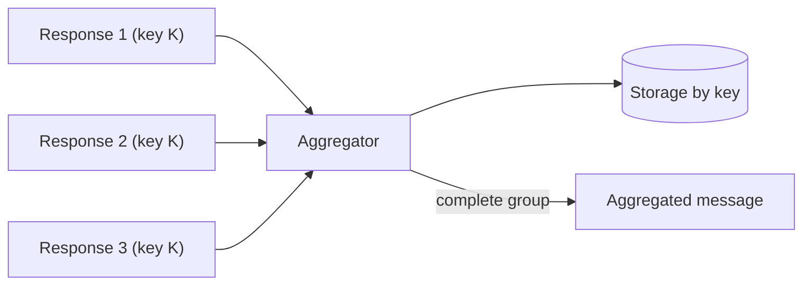

# Aggregator

## Description

The Aggregator is a stateful filter that sits between the incoming message flow and the next step. It stores messages that share a correlation key and, once a completeness condition is met, combines them into a new message published to the output channel.

It's needed when Splitters, Recipient Lists, or publish-subscribe channels produce several related messages, often processed in parallel, and the next step depends on all of them: choosing the best bid among suppliers, or charging the customer only after all items have been picked.

Three decisions shape the pattern: how to correlate, when to consider the group complete, and how to combine the content.

## Problems it solves

- Identifying which messages belong to the same group
- Deciding when there are enough messages to produce a result
- Combining scattered responses into a single message
- Handling late or missing responses in asynchronous systems

## When to use

- Parallel results need to be consolidated before the next step
- After a Splitter, to reassemble the result
- In auctions or quotes, to pick the best response

### When to avoid

- There is a single response per request; plain request-reply is enough
- There is no way to correlate messages or to know when the group ends

## Trade-offs

| Benefit | Cost / Risk |
| --- | --- |
| A single result from many messages | Must maintain state and reliable storage |
| Completeness control driven by the business | Missing messages can block the group |
| Enables upstream parallelism | Storage contention with many simultaneous groups |

Completeness strategies:

- **Wait for all:** complete data, but slow and fragile.
- **Timeout:** decides with whatever arrived in time; needs a plan for when nothing arrives.
- **First best:** acts on the first response and discards the rest.
- **Timeout with override:** ends early if a response reaches the desired quality.
- **External event:** closing is triggered by a business event, such as end of day.

## Diagram

The Aggregator stores messages by correlation key and publishes a single message when the group satisfies the completeness condition.

## Related patterns

- [Splitter](/architecture/eip/message-routing/splitter) — produces the parts that will be recombined
- [Scatter-Gather](/architecture/eip/message-routing/scatter-gather) — uses an Aggregator to collect the responses
- [Composed Message Processor](/architecture/eip/message-routing/composed-message-processor) — Splitter, routing, and Aggregator together
- [Resequencer](/architecture/eip/message-routing/resequencer) — also a stateful filter, but it only reorders
- [Correlation Identifier](/architecture/eip/message-construction/correlation-identifier) — the key that groups the messages
- [Gateway Aggregation](/cloud/cloud-design-patterns/gateways-and-edge/gateway-aggregation) — aggregating calls at a gateway
- [API Composition](/architecture/microservices/service-collaboration/api-composition) — composing data from several services

## Reference

- [Pattern page on Enterprise Integration Patterns](https://www.enterpriseintegrationpatterns.com/Aggregator.html)
