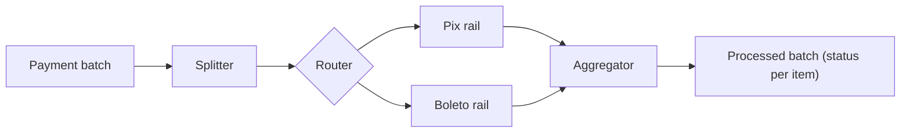

# Composed Message Processor

## Description

The Composed Message Processor handles a composite message: it splits it into submessages, sends each one to the appropriate destination, and then merges the responses into a single message. An Aggregator collects the responses, for example from inventory systems, and combines them according to a predefined rule.

It's a composition of patterns: a Splitter separates the parts, a router (such as a Content-Based Router) distributes them, and the Aggregator reassembles them. The overall flow stays coherent: the order only moves forward once every item has been checked.

## Problems it solves

- Each part of a message must be handled separately, possibly by different systems
- The parts must be recombined before the complete message proceeds
- The process has to wait for all the parts

## When to use

- Orders or documents with items that require checks in different systems
- The final result depends on all the partial responses

## When to avoid

- All parts go to the same processor and can be handled in bulk
- The flow is dynamic or depends on intermediate results; consider the [Process Manager](/architecture/eip/message-routing/process-manager)

## Trade-offs

| Benefit | Cost / Risk |
| --- | --- |
| Composition of simple, reusable patterns | Several moving parts to operate |
| Parallelism in handling the parts | State and correlation in the Aggregator |
| Coherent flow for the caller | The failure of one part affects the whole |

- **Completeness:** choose the Aggregator's strategy (all, timeout, etc.).
- **Partial errors:** define whether the order fails entirely or only partially.

## Diagram

The batch is split, each payment goes through the correct rail, and the responses are collected into a processed batch, with the status of each item. The source illustrates the pattern with a widget and gadget order.

## Related patterns

- [Splitter](/architecture/eip/message-routing/splitter) — splits the message
- [Content-Based Router](/architecture/eip/message-routing/content-based-router) — distributes the parts
- [Aggregator](/architecture/eip/message-routing/aggregator) — collects the responses
- [Scatter-Gather](/architecture/eip/message-routing/scatter-gather) — a related pattern that sends the same message to several destinations
- [Process Manager](/architecture/eip/message-routing/process-manager) — an alternative for dynamic flows

## Reference

- [Pattern page on Enterprise Integration Patterns](https://www.enterpriseintegrationpatterns.com/DistributionAggregate.html)
