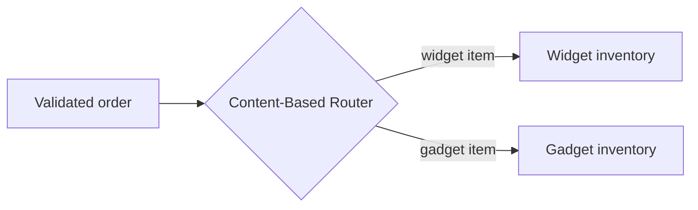

# Content-Based Router

## Description

The Content-Based Router examines the content of each message and sends it to a channel chosen from its data. The criteria can be the existence of a field, the value of a field, or a combination of checks.

The classic example is an order that, once validated, needs an inventory check. If there are several inventory systems, each responsible for certain items, the router reads the order item and forwards it to the right system, so that a logical function implemented by several physical systems is seen as a single one.

In more sophisticated scenarios, the router evolves into a configurable rules engine.

## Problems it solves

- A logical function is spread across several systems, each handling a subset of the messages
- The correct destination depends on data inside the message
- Senders shouldn't know the recipients' topology

## When to use

- The destination varies by message type, value, or field presence
- The split of responsibilities between systems must be hidden from the sender
- Routing rules change and need to live in a single place

## When to avoid

- The sender can trivially decide the destination
- Recipients need to register dynamically; consider the [Dynamic Router](/architecture/eip/message-routing/dynamic-router)
- Recipients change often and the router would become a constant point of change

## Trade-offs

| Benefit | Cost / Risk |
| --- | --- |
| Routing adapted to the content | The router depends on the format of the messages and destinations |
| Centralized, configurable rules | May require frequent changes when new destinations appear |
| Sender unaware of the topology | A rules engine adds complexity |

- **Maintenance:** design the router to be easy to change, since it tends to be a hot spot for change.
- **Messages with no matching rule:** define a default destination or an invalid message channel.

## Diagram

The router reads the order item and forwards it to the inventory system responsible for it.

## Related patterns

- [Message Router](/architecture/eip/message-routing/message-router) — the generic pattern this one is a variant of
- [Message Filter](/architecture/eip/message-routing/message-filter) — discards instead of choosing between destinations
- [Dynamic Router](/architecture/eip/message-routing/dynamic-router) — rules registered by the recipients themselves
- [Recipient List](/architecture/eip/message-routing/recipient-list) — when the list of recipients is computed
- [Gateway Routing](/architecture/cloud-design-patterns/gateways-and-edge/gateway-routing) — routing requests by path or header at a gateway

## Reference

- [Pattern page on Enterprise Integration Patterns](https://www.enterpriseintegrationpatterns.com/ContentBasedRouter.html)
