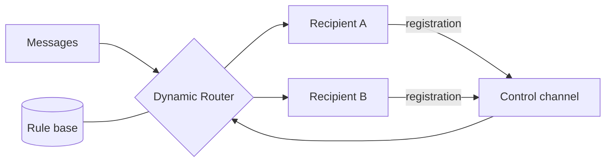

# Dynamic Router

## Description

The Dynamic Router is a router that builds its own rules at runtime. In addition to the normal message channels, it has a control channel. Each potential recipient sends a registration message there, announcing that it exists and under what conditions it can handle a message.

The router stores these conditions in a rule base. When a message arrives, it evaluates the rules and forwards the message to the recipient whose conditions it satisfies. Knowledge about the destinations comes from the recipients themselves, not from configuration in the router.

## Problems it solves

- A router that knows all the destinations becomes coupled to them
- Adding, removing, or changing a recipient forces a change to the router
- Routing must stay efficient and targeted, without broadcasting

## When to use

- Recipients are developed and deployed independently
- The set of destinations changes often or at runtime
- You want to remove the router's dependency on a fixed list

### When to avoid

- Destinations and rules are stable; a Content-Based Router is simpler
- There's no way to guarantee that registrations are trustworthy or authenticated

## Trade-offs

| Benefit | Cost / Risk |
| --- | --- |
| Router decoupled from the recipients | Rule state must be maintained and persisted |
| New recipients join simply by registering | Stale or malicious registrations can divert messages |
| Less maintenance on the router | Behavior is harder to predict and debug |

- **Unregistration:** handle recipients leaving or failing, so you don't route to ones that no longer exist.
- **Initialization:** the router must cope with messages that arrive before the registrations.

## Diagram

Recipients register their conditions on the control channel, and the router uses those rules to forward messages.

## Related patterns

- [Message Router](/architecture/eip/message-routing/message-router) — the generic pattern
- [Content-Based Router](/architecture/eip/message-routing/content-based-router) — the fixed-rules version
- [Recipient List](/architecture/eip/message-routing/recipient-list) — the list of recipients can come from the registered rules
- [Control Bus](/architecture/eip/system-management/control-bus) — control channel for managing the flow

## Reference

- [Pattern page on Enterprise Integration Patterns](https://www.enterpriseintegrationpatterns.com/DynamicRouter.html)
