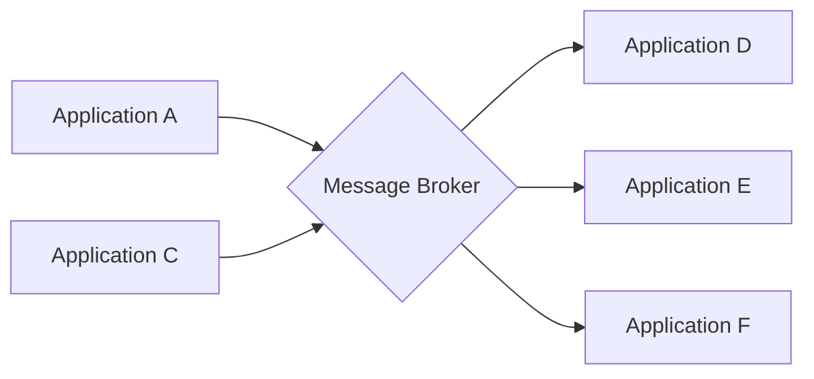

# Message Broker

## Description

The Message Broker puts a central intermediary between senders and receivers. It accepts messages from many sources, determines the correct destination for each one, and forwards it to the appropriate channel. It's a hub-and-spoke architecture that decouples a message's destination from its sender while keeping central control of the flow.

It isn't a single component but an architectural pattern built internally from the routing patterns (Content-Based Router, Message Translator, and others). It can be compared to Pipes and Filters, but at the scale of an entire solution.

To scale, a stateless broker can run as several instances, consuming from a Point-to-Point Channel. A hierarchy is also possible: local brokers handle their subsystem's traffic and pass the rest to a central broker.

## Problems it solves

- Decoupling a message's destination from its sender while keeping central control
- Keeping senders from knowing the receivers' topology
- Concentrating the routing logic of a large integration

## When to use

- Many applications exchange messages and the routing logic should be centralized
- You want a single point for managing the flow
- Whole subsystems need to be decoupled

## When to avoid

- Few participants, with no need for an intermediary
- A single broker would become a bottleneck and a single point of failure
- Routing would get so complex that it would be better to distribute it by context

## Trade-offs

| Benefit | Cost / Risk |
| --- | --- |
| Decoupled senders and receivers | Bottleneck and single point of failure |
| Routing logic kept in one place | A monolithic broker becomes hard to maintain |
| Scales with stateless instances or a hierarchy | Multiple brokers can create routing "spaghetti" |

- **Hierarchy:** local and central brokers reduce complexity per subsystem.
- **Governance:** document the routing rules to avoid tangled flows.

## Diagram

Applications send messages to the broker, which decides the destination of each one.

## Related patterns

- [Message Router](/architecture/eip/message-routing/message-router) — the building block the broker is made of
- [Content-Based Router](/architecture/eip/message-routing/content-based-router) — the broker's typical routing criterion
- [Process Manager](/architecture/eip/message-routing/process-manager) — another central hub, with process state
- [Message Bus](/architecture/eip/messaging-channels/message-bus) — an alternative integration architecture
- [Mediator](/coding/gof/behavioral/mediator) — the same principle in class design
- [Pipes and Filters](/architecture/cloud-design-patterns/messaging/pipes-and-filters) — a comparable style at a smaller scale

## Reference

- [Pattern page on Enterprise Integration Patterns](https://www.enterpriseintegrationpatterns.com/MessageBroker.html)
