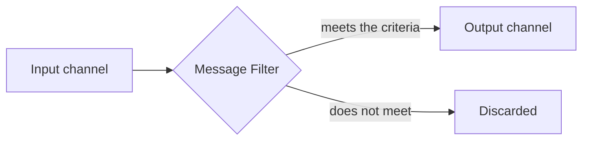

# Message Filter

## Description

The Message Filter is a specialized router with a single output channel. If the message content meets the filter's criteria, it passes through; otherwise, it's discarded.

It exists so that a component doesn't receive messages it isn't interested in. In the classic example, management publishes price changes and promotions to large customers, but each customer only wants to hear about the items it buys. The filter applies that preference consistently, without the sender having to know each customer's interests.

Many brokers implement the pattern through bindings between queues and routing keys: the binding key acts as the filter.

## Problems it solves

- Recipients receive irrelevant messages when the sender broadcasts
- The sender shouldn't know each recipient's preferences
- The interest criterion must be applied uniformly

## When to use

- Part of the messages on a channel are of no interest to a consumer
- Relevance can be decided from the message content
- You want to reduce unnecessary traffic and processing

## When to avoid

- The discarded message is still needed elsewhere; use a router with more than one output
- Silent discarding would hide important errors; prefer an invalid message channel

## Trade-offs

| Benefit | Cost / Risk |
| --- | --- |
| Consumers receive only what matters | Discarded messages are lost if the criterion is wrong |
| Less load and processing cost | One more component to operate |
| Sender decoupled from preferences | Scattered filter rules make things harder to understand |

- **Auditing:** log or count the discarded messages to detect misconfigured filters.
- **Alternative:** a Selective Consumer filters in the consumer itself, instead of in a separate component.

## Diagram

The filter lets through only the messages that satisfy the criterion.

## Related patterns

- [Message Router](/architecture/eip/message-routing/message-router) — the filter is a router with one output
- [Content-Based Router](/architecture/eip/message-routing/content-based-router) — chooses among several outputs by content
- [Selective Consumer](/architecture/eip/messaging-endpoints/selective-consumer) — filtering done in the consumer
- [Publish-Subscribe Channel](/architecture/cloud-design-patterns/messaging/publisher-subscriber) — a channel where filters are used per subscriber
- [Pipes and Filters](/architecture/cloud-design-patterns/messaging/pipes-and-filters) — the filter is a possible stage of the pipeline

## Reference

- [Pattern page on Enterprise Integration Patterns](https://www.enterpriseintegrationpatterns.com/Filter.html)
