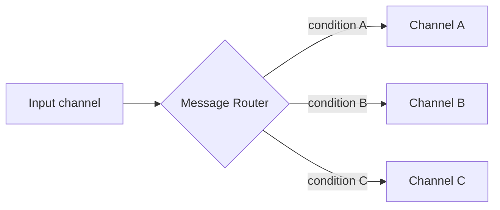

# Message Router

## Description

The Message Router is a special kind of filter that sits between message channels. It consumes a message from an input channel and republishes it to one of several output channels, according to a set of conditions. The message content isn't changed: the router cares only about the destination.

In a regular Pipes and Filters setup, each filter has one input and one output. The router breaks that symmetry by having several outputs, and the surrounding components don't know it exists. This decouples the processing steps: sender and recipients only know their own channels.

This is the base pattern of the router family (Content-Based Router, Message Filter, Dynamic Router, Recipient List, among others), which differ in how they decide the destination.

## Problems it solves

- Pipeline steps connected by channels need to send messages to different filters depending on conditions
- Decision rules scattered across components make maintenance harder
- Changes to message types or processors force changes to several components

## When to use

- The destination decision should live outside the sender and the recipients
- Forwarding rules need to be centralized in a single place
- The flow should be reconfigurable without touching the processing components

### When to avoid

- There is only one possible destination; the router would just be an extra hop
- The decision can be handled by the channel infrastructure itself (for example, subscriptions on a publish-subscribe channel)

## Trade-offs

| Benefit | Cost / Risk |
| --- | --- |
| Routing logic that's centralized and easy to change | The router can become a coupling point and a bottleneck |
| Decoupled senders and recipients | One extra hop per message |
| Messages pass through a single point, preserving arrival order | A single router serializes handling; parallelizing it requires care with ordering |

- **Observability:** the router is a good place to log and measure traffic.
- **Variants:** choosing among them depends on who knows the destinations and how the rule evolves.

## Diagram

The router reads a message from the input channel and forwards it, unmodified, to the channel whose condition it satisfies.

## Related patterns

- [Content-Based Router](/architecture/eip/message-routing/content-based-router) — routes by message content
- [Message Filter](/architecture/eip/message-routing/message-filter) — a single-output router that discards what isn't of interest
- [Dynamic Router](/architecture/eip/message-routing/dynamic-router) — rules built at runtime
- [Recipient List](/architecture/eip/message-routing/recipient-list) — forwards to a computed list of recipients
- [Pipes and Filters](/architecture/cloud-design-patterns/messaging/pipes-and-filters) — the router is a filter with several outputs
- [Message Broker](/architecture/eip/message-routing/message-broker) — composes routers at solution scale
- [Gateway Routing](/architecture/cloud-design-patterns/gateways-and-edge/gateway-routing) — routing requests at a gateway

## Reference

- [Pattern page on Enterprise Integration Patterns](https://www.enterpriseintegrationpatterns.com/MessageRouter.html)
