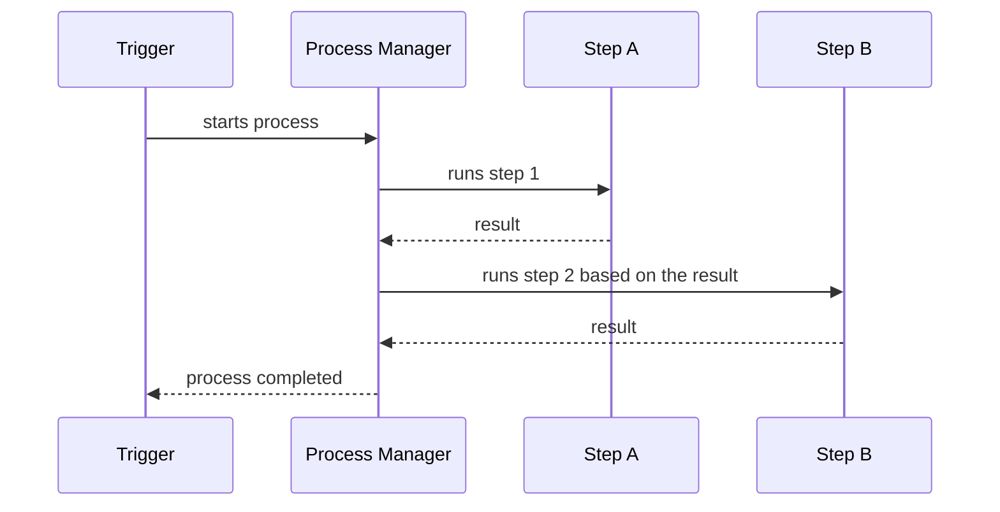

# Process Manager

## Description

The Process Manager is a central coordinator that maintains the state of a sequence of steps and decides the next step based on the results so far. A trigger message starts the process; the manager sends a message to the first processor, which replies when done; the manager then decides what to do next, and so on until the end. Because all traffic goes through this point, the design is called hub-and-spoke.

It's meant for flows that can't be fixed in advance: the steps may not be known at design time, the next one may depend on intermediate results, and some may run in parallel. The Routing Slip, which is simpler, assumes a predetermined linear sequence.

## Problems it solves

- Flows whose path depends on intermediate results
- Parallel steps and conditional decisions
- The need to track the state of a long-running process

## When to use

- The process has decision logic, branching, or parallelism
- You want a single point to see state and handle failures
- The steps aren't known in advance

## When to avoid

- The flow is linear and known; a Routing Slip or Pipes and Filters is enough
- The central coordinator would become a bottleneck or over-engineering for a simple problem

## Trade-offs

| Benefit | Cost / Risk |
| --- | --- |
| Supports any sequence, sequential or parallel | The central hub can become a performance bottleneck |
| Process state is visible and controllable | Excess complexity for simple cases |
| Flow logic is concentrated | Participants are coupled to the coordinator |

- **Persistence:** each instance's state must be durable to survive failures.
- **Compensation:** partial failures require compensation, as in sagas.

## Diagram

The manager keeps the state, sends each step, and picks the next one based on the responses.

## Related patterns

- [Routing Slip](/architecture/eip/message-routing/routing-slip) — an alternative for predetermined linear sequences
- [Message Broker](/architecture/eip/message-routing/message-broker) — routing hub-and-spoke without process state
- [Saga](/architecture/cloud-design-patterns/distributed-coordination/saga) — coordinating long transactions with compensation
- [Scheduler Agent Supervisor](/architecture/cloud-design-patterns/distributed-coordination/scheduler-agent-supervisor) — coordination and recovery of distributed tasks
- [Choreography](/architecture/cloud-design-patterns/distributed-coordination/choreography) — a decentralized alternative, with no coordinator

## Reference

- [Pattern page on Enterprise Integration Patterns](https://www.enterpriseintegrationpatterns.com/ProcessManager.html)
