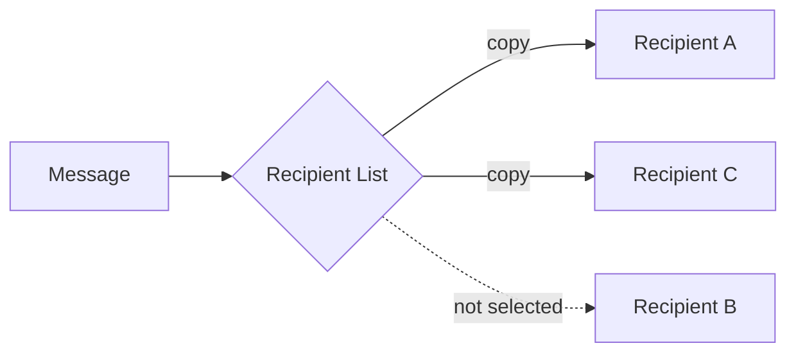

# Recipient List

## Description

The Recipient List routes a message to a dynamically determined list of recipients, like the recipient list of an email. There is one channel for each possible recipient. The component examines each message, works out who should receive it, and forwards a copy to each one's channel.

Conceptually it has two parts: one that computes the list and one that walks the list sending the message. In practice they're usually combined. As with the Content-Based Router, the content normally isn't changed.

Examples: a small order queries one credit agency, but a large order queries several to compare; a request for quote goes only to suppliers chosen by the user.

## Problems it solves

- The sender or the business rule needs to explicitly control the set of recipients
- The set changes per message, depending on data or preferences
- Broadcasting to everyone wastes resources and may be inappropriate
- Each selected recipient needs to receive its own copy

## When to use

- The same message must go to several destinations chosen case by case
- The right recipient depends on a value, preference, or policy
- You need control over who receives, without broadcasting

### When to avoid

- All subscribers always receive everything; a publish-subscribe channel is enough
- A single destination is chosen by content; use a Content-Based Router

## Trade-offs

| Benefit | Cost / Risk |
| --- | --- |
| Precise control over the recipients | The component must know each recipient's channel |
| Avoids unnecessary sends | Partial failure: some receive and others don't |
| Each recipient gets its own copy | Selection rules concentrated in one place |

- **Partial failures:** decide what to do if sending to a recipient fails (retry, ignore, compensate).
- **Responses:** if you need to combine responses, use an Aggregator (see Scatter-Gather).

## Diagram

The list computed for the message includes A and C, which receive copies; B isn't selected.

## Related patterns

- [Content-Based Router](/architecture/eip/message-routing/content-based-router) — the sender doesn't control the destination, which comes from the content
- [Scatter-Gather](/architecture/eip/message-routing/scatter-gather) — uses a Recipient List in the distribution variant
- [Aggregator](/architecture/eip/message-routing/aggregator) — combines the recipients' responses
- [Dynamic Router](/architecture/eip/message-routing/dynamic-router) — can supply the list from registrations
- [Publish-Subscribe Channel](/architecture/cloud-design-patterns/messaging/publisher-subscriber) — an alternative where the subscribers decide

## Reference

- [Pattern page on Enterprise Integration Patterns](https://www.enterpriseintegrationpatterns.com/RecipientList.html)
