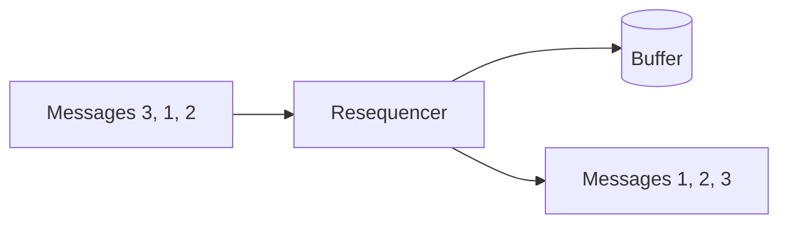

# Resequencer

## Description

The Resequencer is a stateful filter that collects and reorders messages before publishing them. It keeps out-of-order messages in an internal buffer, waits until it has a complete consecutive sequence, and then publishes them in order to the output channel.

The problem arises because routers and parallel paths make each message follow its own route, and some arrive before others. Certain downstream steps, however, require sequence, for example to preserve referential integrity.

The Resequencer doesn't change the content, only the order. For the order to hold, the output channel must also preserve it.

## Problems it solves

- Related messages arrive shuffled after taking different paths
- Consumers depend on order to stay consistent
- Parallel processing breaks the original order

## When to use

- Processing order matters and the transport doesn't guarantee it
- Parallelism or routing shuffles messages from the same sequence
- Messages carry a sequence number

### When to avoid

- Order doesn't matter to the consumer
- The problem can be avoided with a single consumer or key-based partitions
- Delay tolerance is low and a lost message would block the flow

## Trade-offs

| Benefit | Cost / Risk |
| --- | --- |
| Order restored for those who require it | Latency: messages wait for the missing ones |
| Simpler consumers | Memory for the buffer and state |
| Content preserved | A lost message can stall the sequence |

- **Timeout:** define what to do about gaps in the sequence.
- **Sequence per group:** reorder by key, so independent groups don't block each other.

## Diagram

Messages arrive out of order, are held in the buffer, and leave in sequence.

## Related patterns

- [Message Sequence](/architecture/eip/message-construction/message-sequence) — provides the numbering used to reorder
- [Aggregator](/architecture/eip/message-routing/aggregator) — another stateful filter, but one that combines messages
- [Message Router](/architecture/eip/message-routing/message-router) — routing that can shuffle the order
- [Sequential Convoy](/cloud/cloud-design-patterns/messaging/sequential-convoy) — processes related messages in order

## Reference

- [Pattern page on Enterprise Integration Patterns](https://www.enterpriseintegrationpatterns.com/Resequencer.html)
