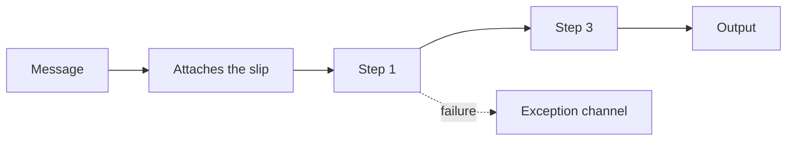

# Routing Slip

## Description

The Routing Slip solves the case where a message must go through a sequence of steps that isn't fixed and can vary from one message to another. A component at the start computes the list of required steps and attaches it to the message as a "routing slip". The message is sent to the first step.

Each processing component is wrapped by a router that reads the slip and forwards the message to the next step. This way, the components stay independent and reusable, and the path is decided per message. A message that fails a rule goes to an exception channel.

## Problems it solves

- Different message types require different validation or processing sequences
- Steps must be skipped depending on context (for example, no decryption on a secure connection)
- Fixing the order in the pipeline design is too rigid

## When to use

- The route depends on the message type or origin
- The steps are known at the start and form a linear sequence
- You want to reuse the same components in different flows

### When to avoid

- The next step depends on intermediate results or there are parallel steps; use a [Process Manager](/architecture/eip/message-routing/process-manager)
- The route is always the same

## Trade-offs

| Benefit | Cost / Risk |
| --- | --- |
| Flexible route per message | Each component needs a router that understands the slip |
| Independent, reusable components | The slip travels with the message and must be protected |
| No central coordinator | Hard to see the flow's state and handle failures |

- **Failures:** the slip has no conditional logic; handle exceptions with a dedicated channel.
- **Tracking:** record the current step to ease diagnosis.

## Diagram

The slip lists steps 1 and 3 (step 2 is skipped) and the message travels only that path.

## Related patterns

- [Process Manager](/architecture/eip/message-routing/process-manager) — an alternative for dynamic flows with parallelism
- [Pipes and Filters](/cloud/cloud-design-patterns/messaging/pipes-and-filters) — the step structure that the Routing Slip makes variable
- [Message Router](/architecture/eip/message-routing/message-router) — each step has a local router
- [Chain of Responsibility](/coding/gof/behavioral/chain-of-responsibility) — a chain of handlers in object orientation

## Reference

- [Pattern page on Enterprise Integration Patterns](https://www.enterpriseintegrationpatterns.com/RoutingTable.html)
