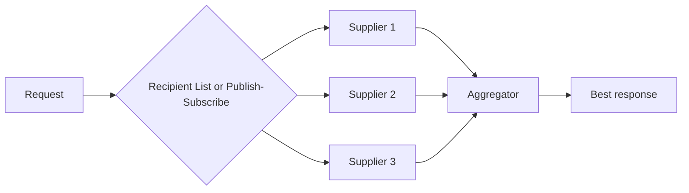

# Scatter-Gather

## Description

Scatter-Gather sends a request to several recipients and uses an Aggregator to collect the responses and combine them into one. The classic example is an out-of-stock item that can be obtained from several suppliers, each with a different price and lead time: you ask all of them for a quote and pick the best.

There are two variants. In the **distribution** variant, a Recipient List sends the request to a controlled list, which gives control over the recipients but requires knowing each one's channel. In the **auction** variant, a publish-subscribe channel broadcasts the request to whoever is interested, using a single channel and giving up some control.

## Problems it solves

- Several recipients must be queried in parallel to compare offers
- Responses arrive at different times and some may never arrive
- The caller needs a single response, not a stream of partial responses

## When to use

- Quotes, auctions, and queries to several redundant sources
- When the total latency should be that of the slowest (or the first) rather than the sum
- The number of recipients can be fixed or computed at runtime

### When to avoid

- There is a single destination; use a plain router
- Multiplied traffic isn't tolerable, or recipients have a high per-query cost
- There's no clear criterion for combining or choosing responses

## Trade-offs

| Benefit | Cost / Risk |
| --- | --- |
| Consolidated response and best choice | More traffic and resource consumption on the recipients |
| Parallelism reduces total latency | Deciding when to stop waiting |
| Distribution gives control; auction gives flexibility | Distribution couples to the channels; auction loses control |

- **Per-route errors:** a failing route can signal overall failure or simply be ignored, depending on the case.
- **Completeness:** reuse the Aggregator's strategies (timeout, first response, etc.).

## Diagram

The request is spread out to the suppliers and the responses are collected into a single result.

## Related patterns

- [Recipient List](/architecture/eip/message-routing/recipient-list) — distributes in the controlled variant
- [Aggregator](/architecture/eip/message-routing/aggregator) — collects the responses
- [Composed Message Processor](/architecture/eip/message-routing/composed-message-processor) — splits into distinct parts instead of replicating
- [Publish-Subscribe Channel](/architecture/cloud-design-patterns/messaging/publisher-subscriber) — used in the auction variant
- [Gateway Aggregation](/architecture/cloud-design-patterns/gateways-and-edge/gateway-aggregation) — aggregates calls to several services
- [API Composition](/architecture/microservices/service-collaboration/api-composition) — combines data from several services

## Reference

- [Pattern page on Enterprise Integration Patterns](https://www.enterpriseintegrationpatterns.com/BroadcastAggregate.html)
