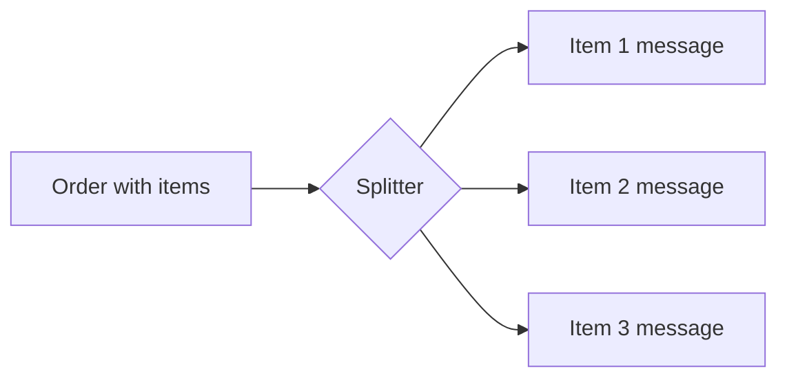

# Splitter

## Description

The Splitter consumes a message that contains a list of repeated elements and publishes a separate message for each element, or for a subset of them. Each resulting message can then be routed and processed independently.

The typical example is an order with several items, where each item may need different handling, such as a check in a different inventory system. The Splitter makes it possible to deal with the order as a whole while still handling each item individually.

So that the parts can be recombined later, it's common for each message to carry a correlation identifier and sequence information.

## Problems it solves

- A composite message has parts that require distinct processing
- Processing everything in bulk prevents parallelism and per-element routing
- Each element needs to reach the system responsible for it

## When to use

- The message contains collections that can be handled separately
- You want to process elements in parallel
- Each part is routed to different destinations

## When to avoid

- Processing requires an atomic view of the whole and can't be split
- The cost of regrouping the parts outweighs the gain from splitting

## Trade-offs

| Benefit | Cost / Risk |
| --- | --- |
| Parallel, granular processing | The parts must be correlated and recombined |
| Independent routing per element | Loss of atomicity of the whole |
| Smaller, simpler messages | More messages in flight |

- **Correlation and sequence:** include a group identifier and each part's position to allow aggregation.
- **Partial failures:** define what happens if only some elements fail.

## Diagram

The composite order is split into one message per item, ready for independent routing.

## Related patterns

- [Aggregator](/architecture/eip/message-routing/aggregator) — recombines the parts after processing
- [Composed Message Processor](/architecture/eip/message-routing/composed-message-processor) — combines Splitter, router, and Aggregator
- [Content-Based Router](/architecture/eip/message-routing/content-based-router) — routes each item to the right system
- [Message Sequence](/architecture/eip/message-construction/message-sequence) — numbering of the parts
- [Correlation Identifier](/architecture/eip/message-construction/correlation-identifier) — links the parts to the original

## Reference

- [Pattern page on Enterprise Integration Patterns](https://www.enterpriseintegrationpatterns.com/Sequencer.html)
