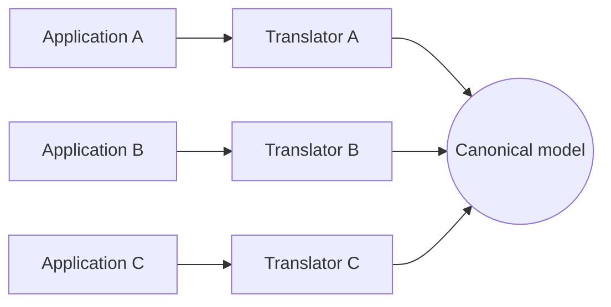

# Canonical Data Model

## Description

The Canonical Data Model defines a common data format, independent of any application, that becomes the *lingua franca* of the integration. Each application only has to translate between its own internal format and the canonical format, never directly to the format of the others.

Without this model, point-to-point integration requires a translator for every pair of applications, and the number of translators grows quadratically. With the canonical model, each application has a single translator, and adding a new participant means writing just one more.

The model belongs to the set of applications rather than to any one system, which keeps one application's format from being imposed on the others.

## Problems it solves

- Applications with different internal formats shouldn't depend directly on each other's format.
- Translations between all pairs grow quickly (two systems need 2 translators, six need 30).
- Adding or replacing an application forces changes to several existing translators.
- There's no common vocabulary for the data being exchanged.

## When to use

- Many applications need to integrate, or that number is expected to grow.
- Producers and consumers need to be decoupled from each other's internal formats.
- The organization wants a shared, governed data vocabulary.

## When to avoid

- Only a few applications (two or three) are integrating: the intermediate model is more work than translating directly.
- Consensus on a common model is infeasible or costly, and the model tends to become a poor lowest common denominator.
- The contexts have genuinely different semantics, and forcing a single model erases important distinctions.

## Trade-offs

| Benefit | Cost / Risk |
| --- | --- |
| One translator per application, regardless of the total | Each message goes through two translations (source to canonical, canonical to target) |
| New applications join without changing existing ones | Effort to design and govern the common model |
| Decoupling between internal formats | The model can become an evolution bottleneck, since changes affect everyone |
| Shared vocabulary | Risk of a model that's too generic and serves no one well |

- Establish a clear process for versioning and evolving the model.
- Use a Format Indicator to support multiple versions side by side.

## Diagram

Each application connects to the canonical model through a single translator, instead of maintaining translators for every other application.

## Related patterns

- [Message Translator](/architecture/eip/message-transformation/message-translator) — performs the conversion between the application format and the canonical one.
- [Normalizer](/architecture/eip/message-transformation/normalizer) — converts varied formats to the common format.
- [Messaging Mapper](/architecture/eip/messaging-endpoints/messaging-mapper) — links the application's internal data to the message format.
- [Format Indicator](/architecture/eip/message-construction/format-indicator) — identifies the version or format used in the message.
- [Message Bus](/architecture/eip/messaging-channels/message-bus) — the bus architecture usually presupposes a canonical model.
- [Message Router](/architecture/eip/message-routing/message-router) — routes messages in the common format.
- [Shared Database](/architecture/microservices/service-collaboration/shared-database) — an integration alternative where the common model is the shared schema.
- [Published Language](/design/ddd/context-mapping/published-language) — the equivalent concept in DDD: a documented language shared across contexts.

## Reference

- [Pattern page at Enterprise Integration Patterns](https://www.enterpriseintegrationpatterns.com/CanonicalDataModel.html)
