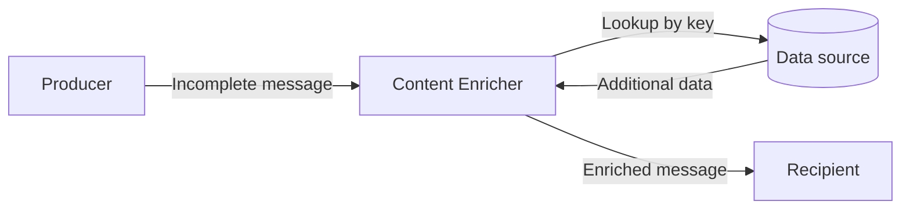

# Content Enricher

## Description

The Content Enricher is a specialized transformer that completes a message with data the recipient needs and the sender didn't send. It uses key fields from the incoming message (a postal code, a customer identifier, an order number) to obtain the missing information and adds it to the content.

The information can come from three sources: a computation (deriving the state from the postal code), the environment (the current timestamp), or another system (database, file, service, directory). The last case is the most common and is what makes the pattern useful in integrations.

As a result, senders don't need to carry every field that any recipient might eventually require, and messages stay lean at the source.

## Problems it solves

- The recipient needs data (name and address) that the message doesn't carry (only a customer ID).
- The sender has no access to the additional information or shouldn't be responsible for it.
- Different recipients require different data, and embedding everything in the original message would bloat it.
- Later steps need to retrieve data that was removed earlier (for example, with a Claim Check).

## When to use

- The source can't provide all the data the target needs, but it's available from a trusted source.
- Identifiers must be converted into complete information before routing or processing.
- Data temporarily stored by a Claim Check must be put back into the message.

### When to avoid

- The additional information is unreliable or changes so quickly that the looked-up value ends up inconsistent.
- The lookup against the external system is slow or has low availability and can become a bottleneck for the flow.
- The sender itself can send the data at no cost; enriching later only adds a dependency.

## Trade-offs

| Benefit | Cost / Risk |
| --- | --- |
| Smaller messages and simple senders | Dependency on an external data source for every message |
| Recipients receive complete data | Additional latency from the lookup |
| Centralized, reusable enrichment | Risk of stale or inconsistent data relative to the moment of the event |
| Avoids duplicating lookup logic across several consumers | Source failures affect the whole flow (requires retry, cache, or fallback) |

- Consider caching for repeated lookups and define the behavior when the source is unavailable.
- Decide whether the enriched message preserves the original fields or replaces them.

## Diagram

The enricher uses a key from the message to fetch the missing data from the source and delivers the complete message to the recipient.

## Related patterns

- [Content Filter](/architecture/eip/message-transformation/content-filter) — the inverse: removes unnecessary data instead of adding it.
- [Message Translator](/architecture/eip/message-transformation/message-translator) — enrichment by computation is close to a simple translation.
- [Claim Check](/cloud/cloud-design-patterns/messaging/claim-check) — the stored data is later retrieved by an enricher.
- [Envelope Wrapper](/architecture/eip/message-transformation/envelope-wrapper) — another way to add information to the message, aimed at headers.
- [Message Filter](/architecture/eip/message-routing/message-filter) — discards entire messages, doesn't change the content.
- [Message Channel](/architecture/eip/messaging-channels/message-channel) — the channel the enriched message continues through.

## Reference

- [Pattern page at Enterprise Integration Patterns](https://www.enterpriseintegrationpatterns.com/DataEnricher.html)
