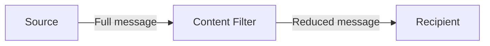

# Content Filter

## Description

The Content Filter removes from a message the fields the recipient doesn't need, delivering a simpler, leaner version. It can also flatten nested structures, turning a deep tree of repeating groups into an easy-to-process list of elements.

Messages coming from external systems or packages often reflect normalized database structures, with many levels and repeating groups. When known constraints make that complexity unnecessary, the filter eliminates the excess and spares consumers from interpreting it.

It's the opposite of the Content Enricher: instead of adding what's missing, it removes what's superfluous. Don't confuse it with the Message Filter, which discards entire messages; here the message still exists, just with less content.

## Problems it solves

- The message is large and the recipient uses only a few fields.
- The nested or repetitive structure is more complex than the consumer needs.
- Sensitive or irrelevant data shouldn't reach certain recipients.
- The cost of transmitting and parsing useless fields hurts performance.

## When to use

- The recipient needs only part of the message.
- Exposure of sensitive information to a specific consumer must be limited.
- Complex structures must be simplified or flattened before moving on.

### When to avoid

- Other downstream consumers may need the removed fields and there's no way to recover them (consider a Claim Check to store the content).
- What you want is to discard entire messages: use a Message Filter.
- Removing fields hides information needed for auditing or diagnosis.

## Trade-offs

| Benefit | Cost / Risk |
| --- | --- |
| Smaller, simpler messages for the consumer | Irreversible loss of the removed fields |
| Less exposure of sensitive data | Filtering rules must keep up with schema changes |
| Less processing and traffic | One more component in the chain |

- Document clearly which fields are kept and which are discarded.
- To preserve data that will be used later on, store it beforehand and retrieve it afterward with a Claim Check and a Content Enricher.

## Diagram

The filter receives the full message, discards the unnecessary fields, and delivers a simplified version to the recipient.

## Related patterns

- [Content Enricher](/architecture/eip/message-transformation/content-enricher) — the inverse: adds missing data.
- [Claim Check](/cloud/cloud-design-patterns/messaging/claim-check) — stores data so it can be retrieved later, whereas the filter discards it for good.
- [Message Translator](/architecture/eip/message-transformation/message-translator) — the filter can be seen as a translation that reduces the content.
- [Message Filter](/architecture/eip/message-routing/message-filter) — discards entire messages; the Content Filter removes fields.
- [Splitter](/architecture/eip/message-routing/splitter) — splits the message into parts, another way to simplify complex structures.
- [Channel Adapter](/architecture/eip/messaging-channels/channel-adapter) — can apply the filtering when reading data from external systems.

## Reference

- [Pattern page at Enterprise Integration Patterns](https://www.enterpriseintegrationpatterns.com/ContentFilter.html)
