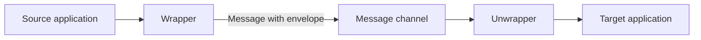

# Envelope Wrapper

## Description

The Envelope Wrapper wraps an application's data in an "envelope" that meets the requirements of the messaging infrastructure and, at the destination, removes that envelope to return the original data. The message usually has a header, aimed at the infrastructure (routing, identification, security), and a body with the application data.

Existing applications typically don't know about the required header fields and may treat them as an error; routing components, in turn, may reject messages that lack those fields. The wrapper resolves the deadlock: it wraps the message on the way out of the application and unwraps it on arrival.

In general terms, the flow has two steps: a wrapper on the sender side, which adds headers or applies required transformations (for example, encryption), and an unwrapper on the receiver side, which reverses those operations before delivering the data to the application.

## Problems it solves

- Legacy applications don't produce the header fields the messaging infrastructure requires.
- Applications not prepared for headers may fail when they receive fields they don't expect.
- Requirements such as encrypting, signing, or compressing the content must be applied without changing the application.
- Routing and tracking components need metadata that the original body doesn't carry.

## When to use

- An existing application needs to take part in a message exchange that imposes headers or an envelope format.
- Encryption, signing, or compression must be applied transparently to the applications.
- Several systems share an infrastructure with a standardized envelope format.

## When to avoid

- The application can already produce and consume the header-based format natively.
- The envelope adds no useful information for the infrastructure and only adds processing.
- The need is to convert the content, not wrap it: use a Message Translator.

## Trade-offs

| Benefit | Cost / Risk |
| --- | --- |
| Existing applications join the messaging without changes | Extra wrap and unwrap steps on every message |
| Headers and security handled centrally | Wrapper and unwrapper must always be aligned in version and format |
| Metadata-based routing without touching the body | If the unwrapper fails, the application receives invalid data or nothing |

- Make sure the wrapper/unwrapper pair is symmetric; any divergence corrupts the message.
- If encryption is involved, manage the keys outside the message body.

## Diagram

The wrapper adds the envelope required by the infrastructure and the unwrapper removes it, so the applications work only with the original data.

## Related patterns

- [Message Translator](/architecture/eip/message-transformation/message-translator) — converts the format of the content, whereas the wrapper only wraps it.
- [Content Enricher](/architecture/eip/message-transformation/content-enricher) — can be used to fill in header fields with external data.
- [Content-Based Router](/architecture/eip/message-routing/content-based-router) — uses the envelope fields to decide the routing.
- [Messaging Bridge](/architecture/cloud-design-patterns/messaging/messaging-bridge) — connects messaging systems that require different envelopes.
- [Pipes and Filters](/architecture/cloud-design-patterns/messaging/pipes-and-filters) — wrapper and unwrapper are filters in the processing chain.
- [Decorator](/coding/gof/structural/decorator) — also adds responsibilities around an object without changing it.

## Reference

- [Pattern page at Enterprise Integration Patterns](https://www.enterpriseintegrationpatterns.com/EnvelopeWrapper.html)
