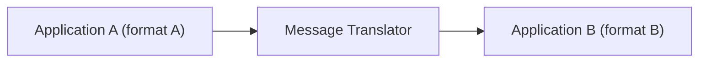

# Message Translator

## Description

The Message Translator is a component (a filter in the Pipes and Filters style) placed between two participants of an integration to convert the format of one message into another. It receives the message in the source format, applies the mapping rules, and emits the message in the format the target expects.

Translation can operate at several levels: data structure (fields, names, types), representation (XML, JSON, CSV, binary), and even transport. Since each application has its own internal model, the translator isolates those differences and keeps the source and target from needing to know each other's format.

It's the messaging-world equivalent of the GoF Adapter: it adapts an interface (here, a message format) so that two incompatible components can talk to each other.

## Problems it solves

- Legacy applications, packages, and partner systems have their own incompatible data models (what a "Customer" is varies from system to system).
- Each application expects to receive messages in its internal format, and changing it to accept another format is usually not feasible.
- External industry standards (such as RosettaNet, ebXML, or OAGIS) differ from the proprietary formats used internally.
- Conversion logic scattered inside the applications increases coupling and makes maintenance harder.

## When to use

- Systems with different formats need to exchange messages and changing them isn't possible or desirable.
- You need to speak an external partner's standard format while keeping the internal format.
- You want to concentrate the conversion in a reusable point that can be tested in isolation.

## When to avoid

- The formats are already compatible, or the only difference is missing fields (in that case, a Content Enricher is enough).
- Many applications exchange messages with each other: point-to-point translations explode in number and a Canonical Data Model is more appropriate.
- The conversion requires complex domain knowledge and becomes business logic hidden in infrastructure.

## Trade-offs

| Benefit | Cost / Risk |
| --- | --- |
| Source and target stay decoupled from each other's format | One more component to deploy, version, and operate |
| Existing applications take part in the integration without modification | Additional latency and processing per message |
| Centralized, testable mapping rules | Schema changes require updating the translator |
| Easy to swap one system for another by changing only the translator | Loss or distortion of information if the models aren't equivalent |

- In integrations with many participants, the number of translators grows quickly; combine with a Canonical Data Model.
- Log and monitor translation failures, directing invalid messages to a dedicated channel.

## Diagram

The message leaves application A in its format, is converted by the translator, and reaches application B in the format it understands.

## Related patterns

- [Canonical Data Model](/architecture/eip/message-transformation/canonical-data-model) — reduces the number of translators by defining a common format.
- [Normalizer](/architecture/eip/message-transformation/normalizer) — combines a router with several translators to unify formats.
- [Content Enricher](/architecture/eip/message-transformation/content-enricher) — adds missing data, rather than just converting the format.
- [Content Filter](/architecture/eip/message-transformation/content-filter) — removes unnecessary data from the message.
- [Envelope Wrapper](/architecture/eip/message-transformation/envelope-wrapper) — adapts the message to the infrastructure's header requirements.
- [Channel Adapter](/architecture/eip/messaging-channels/channel-adapter) — connects the application to the channel; format translation stays in the translator.
- [Pipes and Filters](/architecture/cloud-design-patterns/messaging/pipes-and-filters) — the translator is a filter within a processing chain.
- [Adapter](/coding/gof/structural/adapter) — the object-oriented analog.
- [Anti-Corruption Layer](/architecture/cloud-design-patterns/integration-and-modernization/anti-corruption-layer) — a layer that translates between models to protect the domain.

## Reference

- [Pattern page at Enterprise Integration Patterns](https://www.enterpriseintegrationpatterns.com/MessageTranslator.html)
