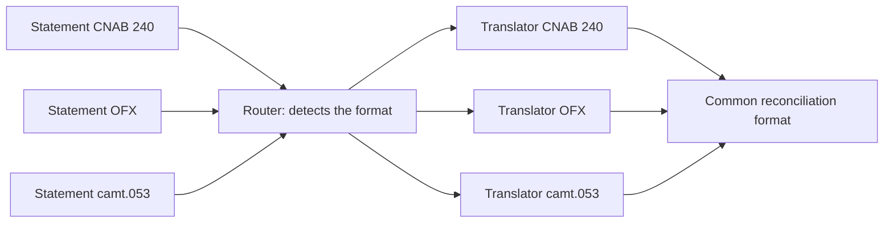

# Normalizer

## Description

The Normalizer processes semantically equivalent messages that arrive in different formats and converts them to a single common format. It's composed of a Message Router, which identifies the type of each incoming message, and a set of Message Translators, one for each known format, all producing the same output.

The central challenge is format detection. Partners rarely provide a reliable type, and messages often arrive as files (CSV, XML without a schema). The router relies on indirect clues: the root element of the XML, the presence of specific nodes (via XPath), the number and types of fields in a CSV, or even the file name and folder, which work as an improvised Datatype Channel.

With the data normalized, all downstream processing works with a single structure, without worrying about the variety of inputs.

## Problems it solves

- Many partners send the same information, each in its own format.
- The message type isn't reliably indicated.
- Downstream processing would be full of branches to handle each format.
- Adding a new partner shouldn't affect the rest of the flow.

## When to use

- Semantically equivalent data arrives in several formats, typically from B2B partners.
- Identifying the type depends on inspecting the message's content or context.
- You want consumers to always receive a consistent format.

## When to avoid

- There are only one or two known formats: a simple Message Translator does the job.
- Messages already carry a reliable format indicator; a Content-Based Router with a Format Indicator is enough.
- The input formats aren't semantically equivalent and require different business logic in each case.

## Trade-offs

| Benefit | Cost / Risk |
| --- | --- |
| Simplified downstream processing, with a single format | Heuristic-based format detection can be wrong |
| New partners join by adding just a translator | Each new format requires maintaining the translator and the detection criterion |
| Isolation from input variety | Unrecognized messages need handling (invalid message channel) |

- Define a destination for messages whose format isn't recognized.
- Monitor the detection failure rate per partner.

## Diagram

The router identifies the format of each message and sends it to the corresponding translator; all translators produce the same common format. The source illustrates the pattern with a widget and gadget order.

## Related patterns

- [Message Translator](/architecture/eip/message-transformation/message-translator) — performs the conversion of each format.
- [Canonical Data Model](/architecture/eip/message-transformation/canonical-data-model) — the common output format is usually the canonical model.
- [Content-Based Router](/architecture/eip/message-routing/content-based-router) — the basis of the router that detects the format.
- [Format Indicator](/architecture/eip/message-construction/format-indicator) — when the message declares its format, detection becomes trivial.
- [Datatype Channel](/architecture/eip/messaging-channels/datatype-channel) — file names or folders can play this role.
- [Invalid Message Channel](/architecture/eip/messaging-channels/invalid-message-channel) — destination for messages of unknown format.

## Reference

- [Pattern page at Enterprise Integration Patterns](https://www.enterpriseintegrationpatterns.com/Normalizer.html)
