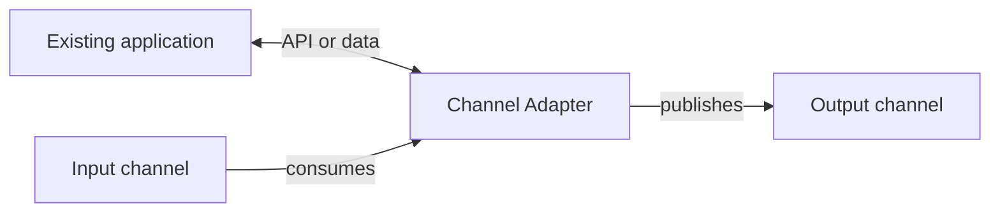

# Channel Adapter

## Description

The Channel Adapter connects an application that doesn't know how to send or receive messages to the messaging system. It reads data through the application's API or data layer and publishes it as messages on a channel; in the opposite direction, it receives messages from the channel and triggers application functions through an interface the application offers.

The adapter is itself a messaging client. Once the application has an adapter, it takes part in the integration without being rewritten around the messaging system.

Where the adapter attaches depends on the application's architecture and on the data the integration needs: it can be the user interface, a business API, the logic layer, or the database directly. Don't confuse it with the GoF Adapter, which converts interfaces between classes inside a program.

## Problems it solves

- Existing applications weren't designed to use messaging and have no messaging system client.
- Each application exposes interfaces and data differently, and you must choose the right connection point.
- Rewriting legacy applications to take part in the integration is expensive and risky.

## When to use

- Integrating legacy systems or third-party packages with the messaging system.
- Exposing data from a database or an API as messages, and vice versa.
- Connecting an application to several channels without changing its internal code.

## When to avoid

- When the application can easily be modified to use messaging directly through its own endpoint.
- When direct access to the application's database would violate business rules or encapsulation, and a better API exists.

## Trade-offs

| Benefit | Cost / Risk |
| --- | --- |
| An existing application joins the integration without a rewrite | One more component to deploy and maintain |
| Isolates the application from messaging details | Adapting through the database can bypass business logic |
| Reusable for any application with a suitable interface | Message formats may need to be translated |

- **Coupling point:** choose the integration layer (UI, API, logic, data) by weighing stability and access.
- **Translation:** often used together with a Message Translator and a canonical data model.
- **Transactions:** when the adapter both consumes messages and updates the application, use transactional semantics so messages aren't lost.

## Diagram

The adapter turns application data or calls into messages and messages into calls, connecting the application to the channels.

## Related patterns

- [Message Channel](/architecture/eip/messaging-channels/message-channel) — the channel the adapter connects to.
- [Messaging Bridge](/architecture/cloud-design-patterns/messaging/messaging-bridge) — formed by pairs of adapters between messaging systems.
- [Message Bus](/architecture/eip/messaging-channels/message-bus) — uses adapters to connect each system to the bus.
- [Message Translator](/architecture/eip/message-transformation/message-translator) — converts the format between application and channel.
- [Canonical Data Model](/architecture/eip/message-transformation/canonical-data-model) — the common format the adapter translates to.
- [Transactional Client](/architecture/eip/messaging-endpoints/transactional-client) — ensures atomicity between the application and messaging.
- [Adapter](/coding/gof/structural/adapter) — same name, but it converts interfaces between classes and doesn't integrate applications through messaging.
- [Ambassador](/architecture/cloud-design-patterns/integration-and-modernization/ambassador) — helper proxy that also mediates an application's communication with the outside world.

## Reference

- [Pattern page on Enterprise Integration Patterns](https://www.enterpriseintegrationpatterns.com/ChannelAdapter.html)
