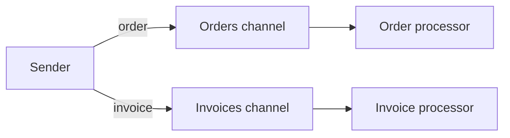

# Datatype Channel

## Description

The Datatype Channel dedicates one channel to each type of data. All messages on a given channel have the same format and meaning, and the sender picks the channel according to the type of what it's sending (for example, one channel for purchase orders and another for invoices).

This way, the receiver knows what to expect just from the channel a message came from. It doesn't need to inspect the content to decide how to handle it, which simplifies the consuming code and reduces the chance of misinterpreting a message.

The cost is a multiplication of channels: each new data type requires a new channel, and the sender now needs to know the mapping between types and channels.

## Problems it solves

- Receivers don't know how to process a message when different types arrive mixed on the same channel.
- Inspecting each message to find out its type adds dispatch logic to every consumer.
- Messages in an unexpected format reach consumers that don't understand them and cause failures.

## When to use

- There are a few well-defined data types, each with its own consumers.
- The consumer specializes in a single type of document or command.
- You want security and monitoring that differ by data type.

### When to avoid

- When the number of types is large or changes often, leading to an explosion of channels; consider a format indicator inside the message or a canonical data model.
- When messages differ only in small details of the same type.

## Trade-offs

| Benefit | Cost / Risk |
| --- | --- |
| The receiver knows the type from the channel, without inspecting the message | More channels to create, name and administer |
| Failure isolation by data type | The sender must know the type-to-channel mapping |
| Access control and metrics per type | Format evolution requires coordination across channels |

- **Alternatives:** a format indicator in the message itself allows a single channel, at the cost of dispatch logic in the consumer.
- **Versions:** versioning the format often means a new channel or a version field.

## Diagram

The sender picks the channel according to the data type, and each processor receives only the format it knows how to handle.

## Related patterns

- [Message Channel](/architecture/eip/messaging-channels/message-channel) — the general concept this pattern specializes.
- [Invalid Message Channel](/architecture/eip/messaging-channels/invalid-message-channel) — destination for messages that still arrive in an incorrect format.
- [Message Bus](/architecture/eip/messaging-channels/message-bus) — uses per-data-type channels to route messages to the right endpoints.
- [Format Indicator](/architecture/eip/message-construction/format-indicator) — an alternative that marks the format inside the message.
- [Command Message](/architecture/eip/message-construction/command-message) — a common message type on dedicated channels.
- [Canonical Data Model](/architecture/eip/message-transformation/canonical-data-model) — reduces the variety of types to translate.
- [Message Dispatcher](/architecture/eip/messaging-endpoints/message-dispatcher) — distributes messages to the right consumers.
- [Selective Consumer](/architecture/eip/messaging-endpoints/selective-consumer) — filters by type when there are no dedicated channels.

## Reference

- [Pattern page on Enterprise Integration Patterns](https://www.enterpriseintegrationpatterns.com/DatatypeChannel.html)
