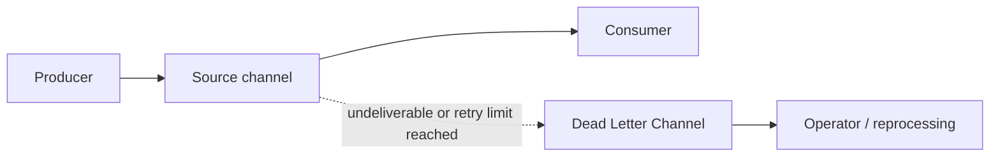

# Dead Letter Channel

## Description

The Dead Letter Channel is the destination where the messaging system moves a message it has decided it cannot or should not deliver. Instead of losing the message or letting it block normal traffic, it's preserved in a separate channel, also known as a dead letter queue (DLQ).

In general, each machine running the messaging system has its own local dead letter channel, so that moving a message to it is a local operation, without the risk of a network transfer. The system also usually records where the failure occurred and, optionally, the channel originally intended.

In many products the mechanism is automatic: after a configured number of delivery attempts, or when the message expires, it's forwarded to the dead letter channel. Not every product offers it, and some require explicit configuration.

## Problems it solves

- Messages that can't be delivered would be silently lost.
- A problematic message redelivered indefinitely blocks or degrades consumption of the others.
- Operators need to know what failed, where and why, so they can fix it and, if appropriate, resend.

## When to use

- Losing messages is unacceptable and you need to be able to inspect them later.
- There is a retry or validity limit, and messages that exceed it must be set aside.
- Consumers may fail persistently with certain messages (poison messages).

### When to avoid

- When losing some messages is acceptable and the cost of operating the channel isn't worth it.
- When there is no process to monitor and handle the channel: it becomes a forgotten dumping ground.

## Trade-offs

| Benefit | Cost / Risk |
| --- | --- |
| No message is silently lost | Someone must monitor and drain the channel |
| The main flow continues unblocked | Dead messages may contain sensitive data and need protection |
| Failure metadata aids diagnosis | Reprocessing can reintroduce duplicates or break ordering |

- **Retry limit:** choose a number of redeliveries that absorbs transient failures without taking too long to isolate permanent ones.
- **Alerts:** configure alerts on the channel's depth and message age.
- **Reprocessing:** define how and when to return messages to the flow, preferring idempotent consumers.
- **Retention:** establish how long dead messages are kept.

## Diagram

When a message can't be delivered or exceeds the retry limit, it's moved to the dead letter channel, where an operator or process analyzes it.

## Related patterns

- [Invalid Message Channel](/architecture/eip/messaging-channels/invalid-message-channel) — for messages that are invalid for the receiver, not merely undelivered.
- [Guaranteed Delivery](/architecture/eip/messaging-channels/guaranteed-delivery) — persistence prevents loss; the dead letter channel covers what still isn't delivered.
- [Message Channel](/architecture/eip/messaging-channels/message-channel) — the general channel concept.
- [Message Expiration](/architecture/eip/message-construction/message-expiration) — expired messages usually go to the dead letter channel.
- [Message Store](/architecture/eip/system-management/message-store) — stores messages for later analysis.
- [Retry](/architecture/cloud-design-patterns/resiliency/retry) — retries happen before a message is considered dead.

## Reference

- [Pattern page on Enterprise Integration Patterns](https://www.enterpriseintegrationpatterns.com/DeadLetterChannel.html)
