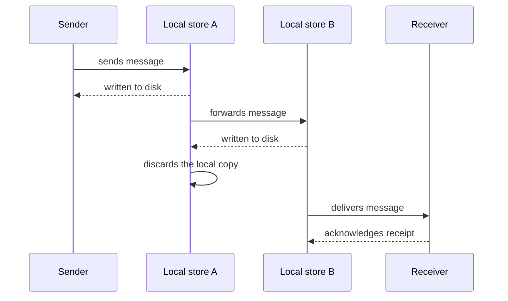

# Guaranteed Delivery

## Description

Guaranteed Delivery makes the messaging system persist messages, so they aren't lost if the system itself fails. Each machine running the system keeps local disk storage, and a send is only considered complete when the message is safely written to it.

When passing the message along, the previous store discards it only after the next one has confirmed it has stored it. This way, the message stays on disk on at least one machine until the receiver acknowledges it.

The guarantee comes at the price of writing to disk at every hop, which increases latency and reduces throughput compared with in-memory-only messages.

## Problems it solves

- The sender needs assurance that the message will arrive even if the messaging system crashes along the way.
- A machine or process crash would lose messages held only in memory.
- The network between sender and receiver is unreliable, or the receiver may be unavailable for a while.

## When to use

- Critical messages, such as orders, payments and business events that can't be lost.
- The receiver may go offline and needs to receive what it missed when it comes back.
- Delivery reliability matters more than latency.

## When to avoid

- Ephemeral or high-frequency data, such as sensor readings or metrics, where losing some is acceptable.
- Low-latency scenarios where the cost of writing to disk at every hop makes the required throughput unattainable.

## Trade-offs

| Benefit | Cost / Risk |
| --- | --- |
| Messages survive messaging system failures | Higher latency and I/O consumption per hop |
| The sender can rely on eventual delivery | Persistent storage to size and protect |
| Offline receivers recover what they missed | At-least-once delivery can produce duplicates |

- **Duplicates:** the guarantee is usually at-least-once delivery; use idempotent receivers.
- **Configuration:** persistence generally has to be enabled per channel or per message.
- **Capacity:** watch disk usage when the receiver is stopped and messages pile up.
- **Transactions:** combine with a transactional client so that sending and receiving are atomic.

## Diagram

Each hop writes the message to disk before acknowledging, and the copy is discarded only once the next store has taken over, until the receiver acknowledges.

## Related patterns

- [Dead Letter Channel](/architecture/eip/messaging-channels/dead-letter-channel) — destination for messages that, even when persisted, couldn't be delivered.
- [Point-to-Point Channel](/architecture/eip/messaging-channels/point-to-point-channel) — a channel to which persistence applies.
- [Publish-Subscribe Channel](/architecture/cloud-design-patterns/messaging/publisher-subscriber) — likewise, for multiple subscribers.
- [Durable Subscriber](/architecture/eip/messaging-endpoints/durable-subscriber) — retains messages for offline subscribers.
- [Transactional Client](/architecture/eip/messaging-endpoints/transactional-client) — groups sending and receiving into a transaction.
- [Idempotent Receiver](/architecture/cloud-design-patterns/messaging/idempotent-consumer) — tolerates the duplicates of at-least-once delivery.
- [Message Expiration](/architecture/eip/message-construction/message-expiration) — limits how long a message remains valid.
- [Message Store](/architecture/eip/system-management/message-store) — records messages for auditing and analysis.

## Reference

- [Pattern page on Enterprise Integration Patterns](https://www.enterpriseintegrationpatterns.com/GuaranteedMessaging.html)
