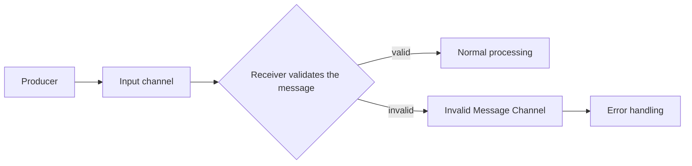

# Invalid Message Channel

## Description

The Invalid Message Channel is a separate channel to which the receiver diverts messages it received but can't understand or process, for example because of an incorrect format, missing fields or content that violates the expected contract. Instead of failing, discarding the message or stalling the normal flow, the receiver moves it to this channel.

Administrators define one or more channels of this kind when designing the system. Since healthy traffic never passes through there, problematic messages don't interfere with normal operation, and an error-handling process can be attached to the channel to inspect them and diagnose the cause.

The important distinction is that the message reached its destination but is invalid for it. This differs from the Dead Letter Channel, which handles messages the messaging system couldn't deliver.

## Problems it solves

- The receiver gets a message that makes no sense and must neither fail nor process it incorrectly.
- Repeated bad messages block the queue or cause reprocessing loops.
- Without a destination for them, invalid messages are lost and nobody can diagnose the problem.

## When to use

- The receiver validates message content and can reject messages explicitly.
- It's important to preserve invalid messages for analysis, correction and possible reprocessing.
- Several producers send to the same channel and not all of them respect the contract.

## When to avoid

- When the failure is transient (for example, a dependency is down): the message is valid and should be retried, not diverted.
- When the channel is fully controlled and validated at the source, and rejections are practically impossible.

## Trade-offs

| Benefit | Cost / Risk |
| --- | --- |
| The normal flow isn't interrupted by bad messages | Someone must monitor and handle the invalid-message channel |
| Problematic messages are available for diagnosis | Potentially sensitive data is retained and needs protection |
| Clear separation between content errors and delivery errors | The receiver must implement validation and the decision to divert |

- **Context:** include in the diverted message the reason for rejection and the source channel to ease diagnosis.
- **Reprocessing:** after fixing the cause, define how to reinsert the messages into the flow.
- **Alerts:** growth of the channel is a sign of a contract problem between producer and consumer.

## Diagram

The receiver validates each message; valid ones follow the normal flow and invalid ones go to the dedicated channel, where an error process analyzes them.

## Related patterns

- [Dead Letter Channel](/architecture/eip/messaging-channels/dead-letter-channel) — handles messages that couldn't be delivered, rather than invalid messages.
- [Datatype Channel](/architecture/eip/messaging-channels/datatype-channel) — per-type channels reduce the chance of a wrong format.
- [Message Channel](/architecture/eip/messaging-channels/message-channel) — the general channel concept.
- [Message Expiration](/architecture/eip/message-construction/message-expiration) — expired messages can also be diverted.
- [Retry](/architecture/cloud-design-patterns/resiliency/retry) — transient failures call for a retry, not diversion as invalid.
- [Service Activator](/architecture/eip/messaging-endpoints/service-activator) — an endpoint that typically validates and dispatches the message.

## Reference

- [Pattern page on Enterprise Integration Patterns](https://www.enterpriseintegrationpatterns.com/InvalidMessageChannel.html)
